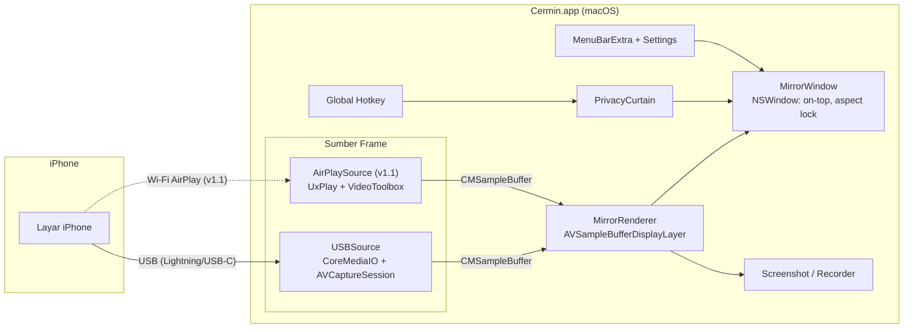
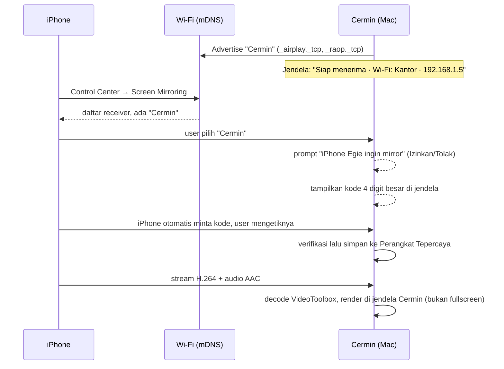

# PRD — Cermin: Mirror iPhone ke macOS (tanpa watermark, Mac tetap bisa dipakai)

| Field | Isi |
|---|---|
| Nama produk (kerja) | **Cermin** (boleh diganti) |
| Platform | macOS native (Swift + SwiftUI/AppKit) |
| Versi dokumen | 1.0 |
| Tanggal | 3 November 2026 |
| Owner | Egie |
| Status | Draft → siap untuk Claude Design → Claude Code |
| Alur kerja | **PRD (dokumen ini) → Claude Design (Bagian 3) → Claude Code (Bagian 4)** |

---

## Daftar Isi

1. **Bagian 1 — PRD**: masalah, tujuan, pengguna, lingkup, requirement, metrik, risiko, referensi kompetitor (ApowerMirror & Reflector 4)
2. **Bagian 2 — Spec Fitur & Teknis**: arsitektur, stack, spec per fitur, izin
3. **Bagian 3 — Design Brief** (untuk Claude Design)
4. **Bagian 4 — Task Breakdown** (untuk Claude Code) + prompt pembuka
5. **Bagian 5 — Checklist Uji Manual**

---

## Status Implementasi (3 November 2026)

| Rilis | Status |
|---|---|
| v1.0 USB (FR-1 s/d FR-16) | **Selesai di kode**, belum dites dengan iPhone asli (checklist Bagian 5) |
| v1.1 Wireless (FR-20 s/d FR-28) | **Selesai di kode** (Opsi A: UxPlay subprocess + RTP). Dites end-to-end memakai uxplay palsu + stream H.264 sungguhan; belum dengan iPhone |
| FR-17 device frame, FR-18 rekam, FR-19 freeze | Belum (Could) |
| v1.2 kontrol, v2-A QR→Safari, v2-B app iOS | Belum (opsional / menunggu hasil spike) |

**Deviasi dari spec:**
- **SwiftPM + `scripts/build.sh`** menggantikan XcodeGen (T0.1), karena Mac pengembang hanya punya Command Line Tools.
- **`@ViewState`** menggantikan `@State`: SDK macOS 27 menjadikan `@State` macro yang plugin-nya hanya ada di Xcode.
- **Rotasi** mempertahankan **sisi panjang** jendela (bukan tinggi), supaya landscape tidak melebar melebihi layar.
- **FR-25 (Izinkan/Tolak)** di Opsi A: UxPlay tetap menerima koneksi, tapi Cermin **menahan semua frame** sampai user menekan Izinkan. Tolak = restart UxPlay dengan `-block <deviceID>`.
- **Port wireless 7300–7302** (bukan 7000), jadi tidak bentrok dengan AirPlay Receiver bawaan. Peringatan "matikan receiver bawaan" tetap ada karena iPhone akan melihat dua tujuan.
- **Nama Wi-Fi (SSID)** di D10/D14 hanya tampil bila macOS mengizinkan (butuh izin Lokasi); bila tidak, tampil IP saja.
- **UxPlay dikunci ke commit `534e2cc` (1.74)**, bukan rilis v1.73.7: pairing kode v1.73.7 menolak proof SRP 20-byte dari iOS 27 sehingga kode diminta terus. Versi ini juga sudah punya `-p2p` (FR-28). Cermin memberi UxPlay `-key` dan `-m` permanen supaya pairing diingat setelah restart.
- **Privasi wireless fail-closed:** frame AirPlay ditahan secara default dan baru tampil setelah Izinkan atau untuk perangkat "selalu izinkan". Password tetap < 6 karakter otomatis jatuh ke kode PIN, tidak pernah ke "tanpa kode".
- **UxPlay dijalankan di pseudo-terminal**, karena log-nya (`printf` tanpa flush) akan tertahan di buffer kalau dialirkan lewat pipe.
- **Toolbar D4 di luar layar iPhone** (permintaan user): panel vertikal di kanan jendela, pindah ke kiri bila mepet tepi layar, selalu tampil selama jendela tampil (bukan hover di atas video). Karena berupa jendela terpisah, toolbar tidak ikut ter-share saat "share window" di meeting. Pilihan sumber D11 jadi dua ikon (USB / Wi-Fi) di toolbar.

---

# BAGIAN 1 — PRD

## 1.1 Ringkasan (TL;DR)

> **Di iPhone tidak perlu install apa pun** untuk v1.0 (USB), v1.1 (AirPlay), dan v2-A (QR → Safari, iOS 27+, eksperimental). Hanya v2-B (opsional, cadangan) yang butuh app di iPhone.

Cermin adalah aplikasi macOS untuk menampilkan layar iPhone di **jendela biasa** yang bisa digeser, diubah ukuran, dan dibuat *always-on-top*. Selama mirroring, **iPhone tetap bisa dipakai langsung** dan **Mac tetap bisa dipakai normal**. Tidak ada watermark, tidak berbayar, dan tidak butuh internet.

Kegunaan utama: **screen share saat meeting** (Zoom/Meet/Teams). Contohnya demo aplikasi telemedicine, di mana peserta perlu melihat aplikasi iOS dan aplikasi/dashboard macOS **bersamaan dalam satu share screen**.

- **MVP (v1.0):** mirror lewat **kabel USB**, pakai mekanisme yang sama dengan QuickTime. Latensi paling rendah, paling stabil, tanpa setup jaringan.
- **v1.1:** mirror **wireless (AirPlay receiver)** di dalam jendela Cermin, tidak fullscreen. iPhone dan Mac harus di **Wi-Fi yang sama**. Koneksi diamankan dengan **kode 4 digit di layar Mac** (gaya Reflector 4), tanpa perlu install app di iPhone.
- **v1.2 (opsional):** **kontrol iPhone dari Mac** (klik/ketik dari Mac).
- **v2-A (eksperimental):** **scan QR dengan kamera iPhone → buka Safari → "Mulai Share"**, tanpa install. Memanfaatkan screen share di Safari **iOS 27+**; harus lolos spike dulu.
- **v2-B (opsional, cadangan):** **app pendamping iOS** dengan scan QR (gaya ApowerMirror), bila v2-A gagal dan AirPlay diblokir jaringan.

## 1.2 Latar Belakang & Masalah

| Solusi yang ada | Masalah |
|---|---|
| **iPhone Mirroring** (bawaan macOS) | iPhone **terkunci** selama mirroring, jadi tidak bisa dioperasikan langsung di tangan. |
| **AirPlay Screen Mirroring ke Mac** (AirPlay Receiver bawaan) | Tampilan di Mac jadi **fullscreen**, sehingga Mac tidak bisa dipakai dan tidak bisa share "iOS + macOS" bersamaan. |
| **ApowerMirror / Reflector 4** | **Berbayar**, versi gratis ada **watermark** atau batas waktu. |
| **QuickTime → New Movie Recording → pilih iPhone** | Sebenarnya jalan, tapi UI-nya untuk merekam, bukan untuk presentasi: tidak ada always-on-top, tidak ada privacy curtain, tidak ingat ukuran/posisi, ada kontrol rekam yang mengganggu. |

**Insight kunci:** macOS sudah punya jalur resmi untuk menangkap layar iPhone lewat USB (CoreMediaIO + AVFoundation, jalur yang dipakai QuickTime). Jalur ini **tidak mengunci iPhone** dan **tidak memaksa fullscreen**. Kita cukup membangun UI presentasi yang bagus di atasnya.

## 1.3 Tujuan & Non-Tujuan

### Tujuan
- G1. Mirror layar iPhone ke jendela macOS yang bisa di-resize, digeser, dan dibuat always-on-top.
- G2. iPhone dan Mac **sama-sama tetap bisa dioperasikan** selama mirroring.
- G3. Hasil mirror **siap di-share di meeting**: bersih, tanpa watermark, tanpa UI yang mengganggu.
- G4. Ada **perlindungan privasi** untuk demo telemedicine, yaitu tombol/hotkey untuk menyembunyikan layar seketika.
- G5. Gratis, offline, tanpa akun, tanpa telemetri.

### Non-Tujuan (tidak dikerjakan)
- Android, Windows, Linux.
- Distribusi App Store dan monetisasi.
- Mirror beberapa iPhone sekaligus (v1 cukup satu perangkat aktif).
- Mirror Mac ke iPhone (arah sebaliknya).
- Editor video, anotasi/menggambar di atas layar, streaming ke internet.
- Virtual camera (mengirim mirror sebagai "kamera" ke Zoom). Bisa dipertimbangkan nanti.
- Mirror **lintas internet / beda jaringan** (fitur "AirCast" remote ApowerMirror). Butuh server relay; di luar lingkup v1.

## 1.4 Target Pengguna & Persona

**Persona utama — "Egie, Product/Engineer di perusahaan telemedicine"**
- Sering demo aplikasi iOS (pasien/dokter) sambil menunjukkan dashboard web/macOS ke klien, tim, atau stakeholder lewat Zoom/Meet.
- Butuh mengoperasikan iPhone **langsung di tangan** (tap, scroll, input) dan tampilannya muncul di Mac.
- Butuh share **seluruh layar Mac** supaya iOS dan macOS terlihat berdampingan.
- Peduli privasi data pasien: notifikasi atau data sensitif tidak boleh bocor saat share.

**Persona sekunder:** developer iOS yang ingin melihat layar iPhone di Mac saat debugging atau rekam demo.

## 1.5 User Stories

| ID | Sebagai… | Saya ingin… | Supaya… |
|---|---|---|---|
| US-1 | presenter | colok iPhone lalu layar langsung muncul di jendela Mac | tidak perlu setup ribet sebelum meeting |
| US-2 | presenter | tetap memakai iPhone dengan tangan selama mirroring | demo terasa natural seperti pengguna asli |
| US-3 | presenter | jendela mirror tetap di atas jendela lain (always-on-top) | saat pindah ke browser/dashboard, iPhone tetap terlihat |
| US-4 | presenter | share seluruh layar Mac di Zoom/Meet | peserta melihat iOS + macOS sekaligus ("double share") |
| US-5 | presenter telemedicine | menekan satu hotkey untuk menyembunyikan layar iPhone seketika | data pasien/notifikasi tidak bocor |
| US-6 | presenter | ukuran dan posisi jendela tersimpan | tidak perlu atur ulang tiap meeting |
| US-7 | presenter | ambil screenshot layar iPhone dari Mac | gampang bikin dokumentasi/bug report |
| US-8 | presenter | mirror tanpa kabel (AirPlay) di jendela biasa | lebih bebas bergerak (v1.1) |
| US-9 | power user | klik/ketik ke iPhone dari Mac | tidak perlu pegang iPhone (v1.2, opsional) |

## 1.6 Lingkup per Rilis

| Rilis | Isi | Alasan urutan |
|---|---|---|
| **v0 — Spike** | Bukti teknis: iPhone muncul sebagai capture device dan preview live tampil | Mengurangi risiko sebelum membangun UI |
| **v1.0 — MVP (USB)** | Mirror USB, jendela presentasi (always-on-top, aspect lock, ingat posisi), Privacy Curtain + hotkey, screenshot, audio toggle, menu bar, settings, onboarding izin | Memenuhi 100% kebutuhan meeting dengan risiko terendah |
| **v1.1 — Wireless** | AirPlay receiver di dalam jendela Cermin (bukan fullscreen), kode 4 digit di layar, prompt Izinkan/Tolak, daftar perangkat tepercaya, diagnosa jaringan, pilih sumber USB/Wireless | Permintaan wireless; lebih kompleks dan berisiko protokol |
| **v1.2 — Kontrol (opsional)** | Kontrol iPhone dari Mac (tap/scroll/ketik) | Butuh perangkat tambahan atau signing developer, jadi bukan inti |
| **v2-A — QR → Safari (eksperimental)** | Scan QR dengan kamera bawaan, buka halaman di Safari, share layar via WebRTC. **Tanpa install** | Bergantung fitur baru iOS 27 yang perilakunya belum terbukti; spike murah dulu (go/no-go) |
| **v2-B — App pendamping iOS (cadangan)** | App iPhone: scan QR di Mac lalu "Start Broadcast" (ReplayKit) | Hanya bila v2-A gagal **dan** jaringan kantor memblokir AirPlay; butuh build & signing app iOS |
| Nanti | Rekam video (+ voiceover), device frame, virtual camera, crop status bar | Nice-to-have |

## 1.7 Requirement Fungsional (MoSCoW)

### v1.0 — MVP (USB)

| ID | Requirement | Prioritas |
|---|---|---|
| FR-1 | Mendeteksi iPhone yang dicolok via USB, lalu mulai mirror otomatis setelah iPhone di-unlock dan di-Trust | Must |
| FR-2 | Menampilkan layar iPhone live di jendela non-fullscreen, aspect ratio terkunci sesuai layar iPhone | Must |
| FR-3 | Mengikuti rotasi iPhone (portrait ↔ landscape) dan menyesuaikan ukuran jendela otomatis | Must |
| FR-4 | Toggle **Always on Top** (tombol, menu, dan shortcut) | Must |
| FR-5 | Jendela **tidak pernah** masuk fullscreen; Mac tetap bisa dipakai penuh | Must |
| FR-6 | **Privacy Curtain**: hotkey global yang langsung mengganti tampilan dengan kartu netral "Layar disembunyikan sementara" | Must |
| FR-7 | Auto-reconnect ketika kabel dicabut lalu dicolok lagi, atau iPhone terkunci lalu dibuka | Must |
| FR-8 | Status jelas saat belum ada perangkat, perangkat terkunci/belum Trust, atau terputus | Must |
| FR-9 | Onboarding izin Kamera (dan Mikrofon jika audio aktif), dengan penjelasan kenapa dibutuhkan | Must |
| FR-10 | Menyimpan ukuran dan posisi jendela per perangkat | Should |
| FR-11 | Screenshot (⌘S) ke file PNG + clipboard | Should |
| FR-12 | Audio iPhone diputar di Mac: on/off + volume | Should |
| FR-13 | Ikon Menu Bar: status, show/hide jendela, toggle on-top, curtain, screenshot, quit | Should |
| FR-14 | Preset ukuran jendela (50% / 75% / 100% / Fit tinggi layar) | Should |
| FR-15 | Settings: default on-top, audio, folder screenshot, hotkey, launch at login | Should |
| FR-16 | Sudut jendela membulat mengikuti bentuk layar iPhone (tanpa bezel) | Should |
| FR-17 | Device frame (bezel iPhone) opsional | Could |
| FR-18 | Rekam video ke file (.mov) | Could |
| FR-19 | Mode "Freeze" (bekukan frame terakhir) sebagai alternatif curtain | Could |

### v1.1 — Wireless

| ID | Requirement | Prioritas |
|---|---|---|
| FR-20 | Cermin tampil sebagai target AirPlay ("Cermin") di Control Center → Screen Mirroring iPhone | Must |
| FR-21 | Video AirPlay ditampilkan di **jendela Cermin yang sama** (semua fitur FR-2 s/d FR-16 berlaku), bukan fullscreen | Must |
| FR-22 | Pilih sumber: USB / Wireless (otomatis pilih USB bila keduanya tersedia) | Should |
| FR-23 | Panduan untuk mematikan "AirPlay Receiver" bawaan macOS bila bentrok port | Must |
| FR-24 | **Kode koneksi di layar** (gaya Reflector 4). Mode: *Kode baru tiap koneksi* (default) / *Password tetap* / *Tanpa kode*. Kode 4 digit tampil besar di jendela Cermin, lalu user memasukkannya di iPhone | Must |
| FR-25 | **Prompt koneksi**: "iPhone Egie ingin mirror — Izinkan / Tolak" sebelum layar tampil | Should |
| FR-26 | **Perangkat tepercaya**: iPhone yang sudah lolos kode diingat (tidak ditanya lagi); bisa dihapus di Settings | Should |
| FR-27 | **Diagnosa jaringan**: tampilkan nama Wi-Fi + IP Mac, status "Siap menerima", serta tips bila iPhone tidak menemukan Cermin (Wi-Fi beda, client isolation, firewall, Personal Hotspot) | Must |
| FR-28 | **Mode langsung tanpa Wi-Fi yang sama (P2P/AWDL)**, eksperimental, bergantung hasil spike | Could |

### v2-A — QR → Safari, tanpa install (eksperimental, iOS 27+)

| ID | Requirement | Prioritas |
|---|---|---|
| FR-50 | Mac menampilkan **QR** berisi URL halaman sender + token sekali pakai (kedaluwarsa 2 menit) | Could |
| FR-51 | Scan dengan **kamera bawaan** iPhone → Safari terbuka → tap "Mulai Share Layar" → layar iPhone tampil di jendela Cermin | Could |
| FR-52 | Halaman mendeteksi dukungan `getDisplayMedia`; bila tidak ada (iOS < 27), tampilkan panduan AirPlay/USB | Could |
| FR-53 | Halaman menampilkan status koneksi + tombol Stop | Could |
| FR-54 | Semua fitur jendela (curtain, screenshot, on-top) berlaku | Could |

### v2-B — App pendamping iOS + QR (cadangan, opsional)

| ID | Requirement | Prioritas |
|---|---|---|
| FR-40 | Mac menampilkan **QR** berisi alamat (IP:port) + token sekali pakai | Could |
| FR-41 | App iOS "Cermin Sender" scan QR, lalu user menekan "Start Broadcast" dan seluruh layar iPhone terkirim ke Mac | Could |
| FR-42 | Bisa tersambung walau mDNS/AirPlay diblokir jaringan (karena alamat langsung dari QR) | Could |

### v1.2 — Kontrol dari Mac (opsional)

| ID | Requirement | Prioritas |
|---|---|---|
| FR-30 | Klik pada jendela mirror menjadi tap di iPhone; drag menjadi swipe | Could |
| FR-31 | Ketik dari keyboard Mac ke field yang aktif di iPhone | Could |
| FR-32 | Tombol Home/App Switcher/Lock | Could |

## 1.8 Requirement Non-Fungsional

| ID | Kategori | Target |
|---|---|---|
| NFR-1 | Latensi USB (glass-to-glass) | ≤ 150 ms (target ≤ 100 ms) |
| NFR-2 | Frame rate USB | Mengikuti iPhone, hingga 60 fps |
| NFR-3 | Latensi Wireless | ≤ 300 ms |
| NFR-4 | Waktu hingga frame pertama | ≤ 3 detik setelah colok + unlock |
| NFR-5 | Resource (Apple Silicon, ukuran 75%) | CPU ≤ 15%, RAM ≤ 250 MB |
| NFR-6 | Stabilitas | Sesi 60 menit tanpa crash/freeze; reconnect ≤ 3 detik |
| NFR-7 | Privasi | Mode USB 100% offline; tidak ada telemetri; frame tidak disimpan kecuali user screenshot/rekam |
| NFR-8 | Kompatibilitas | macOS 14 Sonoma ke atas (dikembangkan di macOS 27); Apple Silicon (Intel best-effort); iOS 15 ke atas |
| NFR-9 | Branding | **Tidak ada watermark**, tidak ada nag screen |
| NFR-10 | Aksesibilitas | Semua tombol punya label VoiceOver dan shortcut; mengikuti Light/Dark mode |

## 1.9 Metrik Sukses

- Dipakai di **≥ 3 meeting nyata** tanpa harus kembali ke ApowerMirror/QuickTime.
- Setup sebelum meeting **≤ 10 detik** (colok → muncul).
- **0 insiden** data sensitif tampil tidak sengaja saat share (Privacy Curtain dipakai bila perlu).
- Tidak ada keluhan "Mac tidak bisa dipakai" atau "iPhone terkunci" selama mirroring.

## 1.10 Asumsi, Risiko & Mitigasi

| # | Risiko | Dampak | Mitigasi |
|---|---|---|---|
| R1 | macOS meminta **izin Kamera** untuk capture layar iPhone (iPhone dianggap capture device) | User bingung | Onboarding menjelaskan "macOS memperlakukan layar iPhone seperti kamera" |
| R2 | Selama capture USB, **audio iPhone bisa pindah ke Mac** (speaker iPhone senyap). Bisa mengganggu saat demo video call telemedicine di iPhone | Sedang | Diuji di Spike. Sediakan toggle audio; dokumentasikan perilakunya |
| R3 | **Notifikasi** (chat pasien, OTP) muncul di mirror saat share | Tinggi (privasi) | Privacy Curtain + rekomendasi **Focus Mode** di iPhone; checklist sebelum meeting |
| R4 | Kabel hanya untuk charging (tanpa data) | iPhone tidak terdeteksi | Pesan troubleshooting di empty state |
| R5 | Device Continuity Camera ikut terdeteksi di discovery | Salah pilih device | Filter berdasarkan media type `muxed` / model "iOS Device" |
| R6 | Wireless: protokol AirPlay dibalik-rekayasa (UxPlay) dan bisa rusak setelah update iOS | v1.1 terganggu | USB tetap jadi jalur utama; pin versi UxPlay; uji setiap update iOS besar |
| R7 | Wireless: **lisensi UxPlay GPL-3.0** | Kalau app dibagikan, source code wajib dibuka (GPL) | Pemakaian pribadi aman; putuskan sebelum distribusi |
| R8 | Wireless: bentrok port dengan AirPlay Receiver bawaan macOS (port 7000) | Gagal listen | Deteksi + panduan mematikan di System Settings |
| R9 | Kontrol dari Mac: macOS tidak menyediakan API publik andal untuk menjadi mouse/keyboard Bluetooth ke iPhone | Fitur v1.2 butuh jalan lain | Lihat opsi di §2.4 F9 (WebDriverAgent atau dongle ESP32) |
| R10 | **Wi-Fi kantor/publik** memakai *client/AP isolation* atau memblokir mDNS (Bonjour), sehingga iPhone tidak menemukan "Cermin" | Wireless gagal saat meeting | Urutan fallback: (1) **USB**, (2) Mac join **Personal Hotspot** iPhone (diuji di spike), (3) mode P2P/AWDL (eksperimental), (4) QR → Safari (v2-A, mDNS diblokir saja), (5) app pendamping (v2-B) |
| R11 | Orang lain di Wi-Fi yang sama mencoba mirror ke Mac saat presentasi | Konten asing tampil di meeting | Kode di layar wajib (FR-24) + prompt Izinkan/Tolak (FR-25); default 1 koneksi aktif |
| R12 | Firewall macOS memblokir koneksi masuk | Wireless gagal | Port tetap (bukan acak) + panduan "Izinkan koneksi masuk" saat pertama kali |

## 1.11 Pertanyaan Terbuka

1. Nama "Cermin" oke, atau ada nama lain?
2. Audio iPhone perlu diputar di Mac, atau cukup video saja?
3. Seberapa penting wireless dibanding USB? (Rekomendasi: USB dulu.) Apakah Wi-Fi kantor yang biasa dipakai meeting memblokir AirPlay? (Cek: bisakah iPhone mirror ke Mac lewat AirPlay bawaan di Wi-Fi tersebut?)
4. Kontrol dari Mac benar-benar dibutuhkan? Kalau ya, pilih jalur dongle ESP32 (perlu hardware ±Rp100rb) atau WebDriverAgent (perlu Xcode + Apple ID)?
5. App hanya untuk pribadi, atau akan dibagikan ke tim? (Berpengaruh ke signing/notarisasi dan lisensi GPL di v1.1.)
6. QR benar-benar dibutuhkan, atau kode 4 digit ala Reflector sudah cukup? (QR tanpa install hanya mungkin di iOS 27+ dan belum terbukti; lihat §2.4 F11.)
7. ~~iPhone sudah iOS 27?~~ **Terjawab: ya, iOS 27.** Syarat v2-A terpenuhi; spike T4.0 bisa dijalankan.

## 1.12 Referensi Kompetitor

### Cara mereka menyambungkan iPhone

| | **ApowerMirror** | **Reflector 4** | **Cermin (rencana)** |
|---|---|---|---|
| Kabel USB (iPhone) | Ada (Windows: perlu driver) | Tidak ada (wireless saja) | **v1.0, jalur utama** |
| AirPlay (Control Center → Screen Mirroring) | Ada, Wi-Fi sama | **Ada, inti produk** | v1.1 |
| App di iPhone | Perlu untuk mode LocalCast ("Mirror Phone to PC" → **Start Broadcast** = ReplayKit) | **Tidak perlu** | Tidak perlu (v2-B opsional, cadangan) |
| QR / PIN | Desktop menampilkan QR/PIN, lalu **app iPhone** scan atau ketik kode | **Kode di layar AirPlay** (Onscreen Code), password, atau tanpa kode | v1.1: kode di layar · v2-A: QR → Safari (iOS 27+) · v2-B: QR + app |
| Prompt Izinkan/Tolak | — | Ada (*Connection Prompts*) | v1.1 |
| Beda jaringan / internet | AirCast (remote, lewat server) | Tidak | Non-goal |
| Banyak perangkat sekaligus | Ada | Ada | Non-goal v1 |
| Device frame | Ada | Ada | Could |
| Rekam (+ voiceover) | Ada | Ada | Could |
| Fullscreen | Ada | Opsional | **Tidak pernah** (sengaja) |
| Harga | Berbayar, watermark di versi gratis | ±US$18 | Gratis, tanpa watermark |

### Kenapa QR ApowerMirror butuh app iPhone
iOS **tidak mengizinkan** scan QR (lewat kamera bawaan) untuk memulai **AirPlay** Screen Mirroring. QR di ApowerMirror hanya dibaca oleh **app ApowerMirror di iPhone**, yang lalu mengirim layar lewat **ReplayKit Broadcast** ("Start Broadcast"). Tanpa app iOS, cara aman paling setara adalah **kode 4 digit AirPlay** seperti Reflector. Kode ini didukung native oleh iOS: setelah memilih "Cermin" di Control Center, iPhone otomatis meminta kode.

**Update iOS 27 (September 2026):** Safari iOS 27 mulai mendukung `getDisplayMedia()` (screen share dari halaman web), dan data kompatibilitas MDN sudah diperbarui per 14 Oktober 2026. Ini membuka peluang **QR → buka link di Safari → share layar tanpa install** (v2-A, §2.4 F11). **Belum terbukti** apakah capture mencakup seluruh layar dan tetap berjalan saat pindah app. Sebelum iOS 27, browser iPhone sama sekali tidak bisa share layar.

### Yang diadopsi Cermin
- Dari **Reflector 4**: kode di layar (3 mode), prompt Izinkan/Tolak, perangkat tepercaya, (nanti) device frame & rekam.
- Dari **ApowerMirror**: jalur USB, alur scan QR (v2-A lewat Safari tanpa install; v2-B lewat app pendamping).
- **Tidak diadopsi**: fullscreen, akun/login, watermark, banyak perangkat sekaligus.

Sumber: [Apowersoft – ApowerMirror iOS](https://www.apowersoft.com/faq/use-apowermirror-ios-app.html), [Apowersoft – ApowerMirror Desktop](https://apowersoft.id/faq/how-to-use-apowermirror.html), [Reflector – Fitur](https://www.airsquirrels.com/reflector/features/mac-and-windows), [Reflector – Security](https://www.airsquirrels.com/reflector/features/security), [Macworld – Reflector 4 review](https://www.macworld.com/article/630338/reflector-4-airplay-review.html), [UxPlay](https://github.com/FDH2/UxPlay), [MDN BCD – getDisplayMedia Safari iOS 27](https://github.com/mdn/browser-compat-data/pull/30732), [BigBlueButton – iOS 27 screen share](https://github.com/bigbluebutton/bigbluebutton/issues/26200).

---

# BAGIAN 2 — SPEC FITUR & TEKNIS

## 2.1 Arsitektur



**Prinsip:** setiap sumber menghasilkan `CMSampleBuffer` dan **satu renderer** menampilkannya, sehingga semua fitur jendela (on-top, curtain, screenshot) otomatis berlaku untuk USB maupun wireless.

## 2.2 Tech Stack

| Lapisan | Pilihan | Catatan |
|---|---|---|
| Bahasa | Swift 6 | Strict concurrency |
| UI | SwiftUI (Settings, MenuBarExtra, onboarding) + AppKit (`NSWindow` untuk jendela mirror) | AppKit dibutuhkan untuk window level, aspect ratio, dan fullscreen behavior |
| Capture USB | `CoreMediaIO` + `AVFoundation` (`AVCaptureSession`, `AVCaptureVideoDataOutput`, `AVCaptureAudioPreviewOutput`) | Jalur yang sama dengan QuickTime |
| Render | `AVSampleBufferDisplayLayer` | Fallback: `AVCaptureVideoPreviewLayer` bila latensi lebih baik |
| Hotkey global | Carbon `RegisterEventHotKey` | Tidak butuh izin Accessibility |
| Penyimpanan setting | `UserDefaults` / `@AppStorage` | Tanpa database |
| Launch at login | `SMAppService.mainApp` | |
| Wireless (v1.1) | [UxPlay](https://github.com/FDH2/UxPlay) (GPL-3.0) + `VideoToolbox` | Dependensi: OpenSSL 3, libplist (Homebrew); GStreamer hanya bila pakai Opsi A |
| QR → Safari (v2-A) | Halaman web + `getDisplayMedia` + WebRTC; penerima `WKWebView` di Mac | Eksperimental |
| App pendamping (v2-B) | iOS app + ReplayKit Broadcast Upload Extension, `Network.framework` di Mac | Cadangan |
| Project | **SwiftPM** (`Package.swift`) + `scripts/build.sh` | Tanpa Xcode; `.app` dirakit + ad-hoc signed oleh script |
| Dependensi pihak ketiga v1.0 | **Tidak ada** | |

## 2.3 Struktur Folder

```
Cermin/
├── Package.swift               # SwiftPM (lihat Status Implementasi)
├── Cermin/
│   ├── App/CerminApp.swift     # @main, MenuBarExtra, Settings scene
│   ├── Capture/
│   │   ├── USBSource.swift     # CMIO enable, discovery, AVCaptureSession
│   │   └── AirPlaySource.swift # v1.1
│   ├── Render/MirrorView.swift # NSView + AVSampleBufferDisplayLayer
│   ├── Window/MirrorWindowController.swift
│   ├── Features/
│   │   ├── PrivacyCurtain.swift
│   │   ├── Screenshot.swift
│   │   └── HotKey.swift
│   ├── UI/                     # Onboarding, EmptyState, Toolbar, Settings (SwiftUI)
│   ├── Info.plist
│   └── Cermin.entitlements
├── CerminTests/                # unit test logika murni (sizing, state machine)
└── scripts/build.sh            # xcodegen + xcodebuild + jalankan
```

## 2.4 Spec per Fitur

### F1 — USB Mirror (FR-1, 2, 3, 7, 8)

**Alur teknis:**
1. Saat app start, aktifkan screen capture devices di CoreMediaIO:
   - `CMIOObjectSetPropertyData` pada `kCMIOObjectSystemObject` dengan selector `kCMIOHardwarePropertyAllowScreenCaptureDevices` = `1`.
2. Cari device dengan `AVCaptureDevice.DiscoverySession(deviceTypes: [.external], mediaType: .muxed, position: .unspecified)`. Untuk macOS < 14 pakai `.externalUnknown`.
   - Device bisa baru muncul **1–3 detik** setelah properti di-set. Observasi `devices` (KVO) + `AVCaptureDevice.wasConnectedNotification` / `wasDisconnectedNotification`.
3. Buat `AVCaptureSession` → `AVCaptureDeviceInput(device:)` → `AVCaptureVideoDataOutput` (kirim frame ke renderer, simpan frame terakhir untuk screenshot) → `AVCaptureAudioPreviewOutput` (audio, bila aktif).
4. Rotasi/resolusi berubah: deteksi perubahan dimensi `CMFormatDescription` lalu update `contentAspectRatio` jendela dengan **tinggi jendela tetap**, lebar menyesuaikan.
5. Jalankan session di background queue, jangan di main thread.

**State machine perangkat:**

```
idle ──(device muncul)──▶ connecting ──(frame pertama)──▶ mirroring
  ▲                          │                               │
  │                     (timeout 5 dtk:                  (device hilang)
  │                   "Buka kunci & Trust")                  │
  └────────────(device hilang)◀──────── disconnected ◀───────┘
                                   (auto retry saat device muncul lagi)
```

**Acceptance criteria:**
- [ ] iPhone yang sudah Trust dan unlocked tampil ≤ 3 detik setelah colok.
- [ ] iPhone tetap bisa dioperasikan normal; jendela mirror ikut berubah real-time.
- [ ] Rotasi iPhone → jendela menyesuaikan ≤ 500 ms tanpa distorsi.
- [ ] Cabut lalu colok ulang → otomatis lanjut tanpa klik apa pun.
- [ ] Hanya device iPhone/iPad (muxed) yang dipilih, bukan Continuity Camera.

### F2 — Jendela Presentasi (FR-2, 4, 5, 10, 14, 16)

- `NSWindow` dengan `titlebarAppearsTransparent`, `.fullSizeContentView`, judul tersembunyi; traffic lights muncul hanya saat hover.
- `contentAspectRatio` = rasio layar iPhone, sehingga resize selalu proporsional.
- `collectionBehavior` menyertakan `.fullScreenNone`, sehingga jendela **tidak bisa** fullscreen (tombol hijau = zoom ke preset "Fit tinggi").
- Always on Top: `window.level = .floating` (toggle). Default dari Settings.
- Sudut membulat: corner radius proporsional terhadap lebar jendela (mirip layar iPhone).
- Ukuran dan posisi disimpan per `device.uniqueID`.
- Drag jendela dari mana saja (di v1.0 klik di area video tidak dikirim ke iPhone).

**Acceptance criteria:**
- [ ] Tidak ada cara (klik/shortcut) yang membuat jendela fullscreen.
- [ ] Saat on-top aktif, jendela tetap terlihat ketika pindah ke app lain dan saat share screen di Zoom/Meet.
- [ ] Restart app → ukuran/posisi kembali seperti terakhir.

### F3 — Privacy Curtain (FR-6, FR-19)

- Hotkey global default **⌃⌥⌘P** (bisa diubah) + tombol di toolbar + menu bar.
- Saat aktif: renderer **berhenti menampilkan frame** dan menampilkan kartu netral (logo kecil + "Layar disembunyikan sementara"). **Default: blank**, bukan freeze, karena frame terakhir bisa berisi data sensitif.
- Ikon menu bar berubah (mis. ikon mata dicoret) sebagai indikator.
- Transisi ≤ 100 ms (tanpa animasi panjang; keamanan lebih penting dari estetika).

**Acceptance criteria:**
- [ ] Hotkey bekerja walaupun app lain sedang fokus (misalnya Zoom/browser).
- [ ] Di rekaman share screen, tidak ada satu pun frame berisi layar iPhone setelah hotkey ditekan.

### F4 — Screenshot (FR-11)
- ⌘S / tombol toolbar: simpan frame terakhir (resolusi asli iPhone) sebagai PNG ke folder setting (default `~/Pictures/Cermin/Cermin YYYY-MM-DD HH.mm.ss.png`) dan salin ke clipboard. Tampilkan toast "Screenshot tersimpan".
- Saat Privacy Curtain aktif, screenshot dinonaktifkan.

### F5 — Audio (FR-12)
- `AVCaptureAudioPreviewOutput` dengan `volume`. Toggle on/off, default **off** (perilaku dikonfirmasi di Spike; lihat R2).

### F6 — Menu Bar (FR-13)
- `MenuBarExtra`: nama device + status (●Mirroring / ○Menunggu), Show/Hide Window, Always on Top ✓, Privacy Curtain ✓, Screenshot, Settings…, Quit.

### F7 — Settings (FR-15)
Tab **Umum** (launch at login, default on-top) · **Tampilan** (sudut membulat, device frame) · **Audio** · **Shortcut** · **Wireless** (v1.1) · **Tentang**.

### F8 — Wireless / AirPlay Receiver (v1.1) (FR-20 s/d FR-28)

**Syarat jaringan:** iPhone dan Mac harus di **jaringan lokal yang sama**, dan jaringan itu harus mengizinkan **mDNS/Bonjour** (UDP 5353) serta koneksi antar-perangkat (tanpa *client isolation*). Ini syarat protokol AirPlay; ApowerMirror dan Reflector juga sama.

**Alur koneksi (yang dialami user):**



- Koneksi berikutnya dari iPhone yang sama (tepercaya) **langsung tersambung** tanpa kode.
- Default **1 koneksi aktif**. Perangkat kedua ditolak selama sesi berjalan (UxPlay memang membatasi 1 klien; opsi `-nohold` justru memutus yang lama, jadi **jangan** dipakai).

**Basis teknis: [UxPlay](https://github.com/FDH2/UxPlay)** (v1.73 stabil, Maret 2026; v1.74 eksperimental, Juni 2026; mendukung macOS Intel & Apple Silicon).

| Kebutuhan | Opsi UxPlay yang relevan |
|---|---|
| Kode di layar (FR-24) | `-pin` (kode acak tiap koneksi) / `-pin 1234` (kode tetap) / `-pw <password>` (min. 6 karakter) |
| Perangkat tepercaya (FR-26) | `-reg [file]` menyimpan klien yang sudah lolos PIN; `-restrict` / `-allow <id>` / `-block <id>` |
| Port tetap untuk firewall (R12) | `-p` (TCP 7100/7000/7001, UDP 6000/6001/7011). Tanpa `-p` port acak dan gagal di balik firewall |
| Ambil video untuk render sendiri | `-vrtp <pipeline>` (forward H.264/H.265 terdekripsi sebagai RTP), `-vs 0` (matikan jendela video bawaan) |
| P2P tanpa Wi-Fi yang sama (FR-28) | Opsi koneksi langsung **AWDL**, khusus host macOS, **eksperimental** di v1.74. Syarat & stabilitas dicek di spike |

**Integrasi (ditentukan di spike T2.1):**
- **Opsi A — subprocess (prototipe cepat):** jalankan `uxplay -pin -p -vs 0 -vrtp …`. Cermin menerima RTP lalu decode sendiri. Kode PIN diambil dari output terminal UxPlay. Prompt Izinkan/Tolak (FR-25) **tidak bisa** di opsi ini.
- **Opsi B — link library (target):** compile bagian protokol UxPlay (`lib/`) ke app. Callback memberi H.264 + PIN + info klien, decode dengan `VideoToolbox`, lalu render ke renderer yang sama dengan USB. Semua fitur (prompt, curtain, screenshot) berlaku.

**Bentrok dengan AirPlay Receiver bawaan macOS:** receiver bawaan juga memakai port 7000, dan iPhone akan melihat **dua** tujuan (nama Mac = fullscreen bawaan, "Cermin" = app ini). Default: app mendeteksi dan memandu user mematikan *System Settings → General → AirDrop & Handoff → AirPlay Receiver*. **Pengecualian:** dokumentasi UxPlay menyebut mode P2P/AWDL justru butuh receiver bawaan **aktif**, jadi spike harus memastikan cara keduanya bisa jalan bersama.

**Kalau iPhone tidak menemukan "Cermin" (FR-27, panel diagnosa):**
1. Tampilkan nama Wi-Fi + IP Mac, dan minta user cek iPhone di Wi-Fi yang sama.
2. Cek izin *Local Network* dan *Firewall* untuk Cermin.
3. Sarankan **USB** (selalu jalan) atau **Personal Hotspot** iPhone (Mac join hotspot iPhone).
4. (Eksperimental) mode P2P.

- Info.plist: `NSLocalNetworkUsageDescription` + `NSBonjourServices` = `_airplay._tcp`, `_raop._tcp`.
- **Lisensi GPL-3.0**: aman untuk pribadi; kalau app dibagikan, source wajib dibuka.

### F9 — Kontrol dari Mac (v1.2, opsional)

| Opsi | Cara kerja | Plus | Minus |
|---|---|---|---|
| **A. WebDriverAgent (XCUITest)** | Install runner WDA ke iPhone via Xcode; Mac kirim tap/swipe/type lewat HTTP over USB (`go-ios`/`pymobiledevice3` untuk tunnel iOS 17+) | Tanpa hardware tambahan | Butuh Xcode + Developer Mode; Apple ID gratis = re-sign tiap 7 hari; latensi gesture 200–500 ms |
| **B. Dongle BLE HID (ESP32-S3)** | ESP32 jadi mouse+keyboard Bluetooth ke iPhone (aktifkan AssistiveTouch); Mac kirim perintah via USB serial | Responsif, terasa native, tanpa signing | Perlu hardware ±Rp100rb + firmware |

Rekomendasi: tunda sampai v1.0 dipakai di meeting nyata. Bisa jadi tidak dibutuhkan, karena use case utama mengoperasikan iPhone langsung di tangan.

### F10 — App Pendamping iOS + Scan QR (v2-B, cadangan) (FR-40 s/d FR-42)

Meniru alur **LocalCast ApowerMirror**. Hanya dibangun bila AirPlay terbukti diblokir di jaringan yang sering dipakai.

| Bagian | Spec |
|---|---|
| Mac | Tampilkan QR berisi `cermin://connect?host=<IP>&port=<port>&token=<sekali-pakai>&fp=<sidik-jari-sertifikat>`. Listener `Network.framework` (TLS) |
| iOS app | Scan QR (VisionKit `DataScannerViewController`), simpan info koneksi ke App Group, tampilkan tombol `RPSystemBroadcastPickerView` ("Start Broadcast") |
| Broadcast Upload Extension | Terima frame ReplayKit, encode H.264 (`VideoToolbox`), kirim via TLS ke Mac. Batas memori extension ketat (±50 MB), jadi encoder harus ringan |
| Mac render | Decode, lalu renderer yang sama (semua fitur jendela berlaku) |

- **Plus:** tidak bergantung mDNS (alamat diambil langsung dari QR); kontrol penuh atas protokol.
- **Minus:** harus build & install app iOS sendiri (Apple ID gratis = re-sign tiap 7 hari, atau Apple Developer US$99/tahun); cek dukungan App Group untuk akun gratis di spike. **Tetap tidak menembus client isolation** karena traffic antar-perangkat tetap diblokir. Untuk kasus itu solusinya USB atau hotspot.

### F11 — QR → Safari, tanpa install (v2-A, eksperimental, iOS 27+) (FR-50 s/d FR-54)

**Alur user:** Mac menampilkan QR, lalu user scan dengan **kamera bawaan** iPhone. Safari membuka halaman sender, user tap **"Mulai Share Layar"** dan memilih di picker sistem. Layar iPhone lalu tampil di jendela Cermin lewat **WebRTC**. Tidak ada yang diinstall.

**Dasar:** Safari iOS 27 mendukung `navigator.mediaDevices.getDisplayMedia()` dan membuka picker screen sharing sistem. iOS ≤ 26 tidak mendukung.

**Wajib lolos spike T4.0 sebelum dibangun (go/no-go):**
1. Yang di-capture **seluruh layar iPhone** atau hanya tab Safari?
2. Capture **tetap jalan saat pindah ke app lain** (misalnya app telemedicine)? **Kalau berhenti, batalkan v2-A**, karena use case utama adalah mengoperasikan app lain.
3. Audio ikut atau tidak; resolusi, fps, dan latensi.
4. Berapa lama sesi bertahan (layar terkunci, Safari di-background lama).

**Tantangan teknis:**

| Masalah | Kenapa | Opsi (diuji di spike) |
|---|---|---|
| **HTTPS wajib** | `getDisplayMedia` hanya jalan di *secure context*; `http://192.168.x.x` tidak termasuk | (a) Mac serve HTTPS self-signed, user tap "lanjutkan" di peringatan Safari (cek apakah tetap dianggap secure context); (b) halaman di domain publik HTTPS + signaling kecil via internet, media tetap langsung di LAN; (c) install profil sertifikat sekali di iPhone (bukan app, tapi tetap "install") |
| Signaling WebRTC | Safari dan Mac harus bertukar SDP/ICE | Server WebSocket kecil di app Mac (opsi a) atau relay publik (opsi b) |
| Penerima di Mac | Perlu stack WebRTC | **`WKWebView` tersembunyi** sebagai penerima (tanpa dependensi). Frame tampil di jendela Cermin; curtain/on-top tetap di level jendela |
| Jaringan | Tetap butuh jaringan yang sama (kecuali pakai TURN, yang berarti lintas internet dan non-goal) | Sama dengan AirPlay; QR hanya menghilangkan ketergantungan mDNS |

- Token sekali pakai di URL QR, kedaluwarsa 2 menit; Mac menolak koneksi tanpa token valid.
- Bila spike **no-go**: tetap pakai USB/AirPlay; v2-B hanya bila AirPlay juga diblokir.

## 2.5 Izin, Info.plist & Entitlements

| Item | Nilai/Alasan |
|---|---|
| `NSCameraUsageDescription` | "Cermin membutuhkan akses 'Kamera' karena macOS memperlakukan layar iPhone yang dicolok sebagai perangkat capture." |
| `NSMicrophoneUsageDescription` | "Untuk memutar audio iPhone di Mac." |
| `NSLocalNetworkUsageDescription` + `NSBonjourServices` (`_airplay._tcp`, `_raop._tcp`) | v1.1 saja (AirPlay). Firewall macOS akan bertanya "Izinkan koneksi masuk", jawab Allow |
| Entitlements (Hardened Runtime) | `com.apple.security.device.camera`, `com.apple.security.device.audio-input` |
| App Sandbox | **Off** untuk v1.0 (distribusi pribadi; menyederhanakan CMIO & v1.1 networking) |
| Signing | "Sign to Run Locally" / Apple ID gratis; notarisasi hanya bila dibagikan |

---

# BAGIAN 3 — DESIGN BRIEF (untuk Claude Design)

> **Instruksi untuk Claude Design:** rancang UI aplikasi macOS native bernama **Cermin** untuk mirror iPhone ke Mac. Gaya: **native macOS** (SF Pro, material/vibrancy sistem, semantic colors, Light & Dark). Utamakan **minimal dan tidak mengganggu**, karena jendela ini akan dilihat peserta meeting. Hasil desain harus mudah diimplementasikan dengan **SwiftUI + AppKit**.

## 3.1 Prinsip Desain
1. **Konten adalah raja.** Saat mirroring, yang terlihat hampir hanya layar iPhone. Kontrol muncul hanya saat hover.
2. **Aman dipresentasikan.** Tidak ada elemen alarm (merah/berkedip) di area yang ikut ter-share. State privasi tampil netral dan profesional.
3. **Native.** Ikuti macOS Human Interface Guidelines: SF Symbols, ukuran kontrol standar, shortcut terlihat di menu.
4. **Nol kebingungan saat setup.** Empty state menjelaskan langkah dengan bahasa sederhana (Bahasa Indonesia).

## 3.2 Daftar Layar & State

| ID | Layar | Isi utama |
|---|---|---|
| D1 | **Onboarding** (3 langkah, sekali saja) | (1) Selamat datang + nilai utama, (2) Izin Kamera beserta penjelasan "kenapa kamera?", (3) Colok iPhone → Trust → Unlock. Tombol "Mulai" |
| D2 | **Empty State – Menunggu iPhone** | Ilustrasi iPhone + kabel, teks "Colokkan iPhone dengan kabel data", checklist status: Kabel terdeteksi → Buka kunci iPhone → Ketuk "Trust/Percayai". Link "Tidak terdeteksi?" (kabel data, Trust, restart) |
| D3 | **Connecting** | Spinner kecil + nama device |
| D4 | **Mirroring (utama)** | Layar iPhone memenuhi jendela, sudut membulat, tanpa chrome. **Saat hover:** toolbar mengambang di atas (material blur) berisi Pin (always on top), Screenshot, Privacy Curtain, Audio, Ukuran (50/75/100/Fit), Settings. Pill status kecil di bawah: "USB · 60 fps" (hilang setelah 2 detik) |
| D5 | **Privacy Curtain aktif** | Area mirror diganti kartu netral: ikon `eye.slash`, teks "Layar disembunyikan sementara", hint hotkey "⌃⌥⌘P untuk menampilkan". Warna netral, rasio jendela tetap |
| D6 | **Terputus** | Overlay "iPhone terputus — menunggu tersambung kembali…" di atas frame terakhir yang di-blur kuat |
| D7 | **Menu Bar** | Ikon template (siluet iPhone); menu sesuai F6; state curtain tampil di ikon |
| D8 | **Settings** | Jendela Settings macOS standar dengan tab: Umum, Tampilan, Audio, Shortcut, Wireless, Tentang |
| D9 | **Toast** | "Screenshot tersimpan" (kapsul kecil, 1,5 detik, di dalam jendela mirror) |
| D10 | **Wireless – siap menerima** (v1.1) | Langkah bergambar: "Di iPhone: Control Center → Screen Mirroring → pilih **Cermin**". Info kecil: nama Wi-Fi + IP Mac, status "Siap menerima" (titik hijau). Banner peringatan bila AirPlay Receiver bawaan masih aktif |
| D11 | **Pilih sumber** (v1.1) | Segmented control USB / Wireless di toolbar/menu |
| D12 | **Kode koneksi** (v1.1) | Kode 4 digit **sangat besar** di tengah jendela (terbaca dari jarak 2 m), teks "Masukkan kode ini di iPhone", nama iPhone yang meminta, tombol Batal |
| D13 | **Prompt koneksi** (v1.1) | Sheet kecil: ikon iPhone + "**iPhone Egie** ingin mirror ke Cermin" · [Tolak] [Izinkan] · checkbox "Selalu izinkan perangkat ini" |
| D14 | **Diagnosa "Cermin tidak muncul di iPhone?"** (v1.1) | Checklist interaktif: Wi-Fi sama? (tampilkan nama Wi-Fi Mac) · Izin Local Network · Firewall · AirPlay Receiver bawaan · Saran: pakai kabel USB / Personal Hotspot |
| D15 | **Settings → Wireless** (v1.1) | Nama receiver, mode kode (Kode baru tiap koneksi / Password tetap / Tanpa kode), daftar Perangkat Tepercaya (hapus), toggle P2P (eksperimental) |
| D16 | **QR koneksi** (v2-A/B, opsional) | QR besar + "Scan dengan kamera iPhone" + timer kedaluwarsa (2 menit, refresh otomatis) + link kecil "Pakai AirPlay saja" |
| D17 | **Halaman sender di Safari iPhone** (v2-A, web mobile) | Judul "Mirror ke Mac Egie", tombol besar **"Mulai Share Layar"**, status (Tersambung · 30 fps), tombol **Stop**. Bila iOS < 27: "Browser ini belum mendukung share layar. Pakai Control Center → Screen Mirroring → Cermin." |

## 3.3 Komponen & Token
- **Jendela mirror:** default tinggi 75% visible screen height; lebar mengikuti rasio iPhone (contoh 1179×2556). Corner radius ≈ 9% dari lebar jendela. Bayangan jendela standar macOS.
- **Toolbar hover:** tinggi 36pt, ikon SF Symbols 15pt, material `.hudWindow`/`.ultraThinMaterial`, radius 10pt, fade 150 ms.
- **Spacing:** 4 / 8 / 12 / 16 / 24.
- **Warna:** semantic system colors + 1 accent (usulan: teal/biru medis yang tenang). Hindari merah kecuali error.
- **Tipografi:** SF Pro (Title 2 untuk empty state, Body/Callout untuk teks, Caption untuk status pill).
- **Ikon app:** konsep "cermin" + "iPhone": dua persegi panjang membulat bertumpuk/terpantul, gaya macOS Big Sur+ (squircle).

## 3.4 Copy (Bahasa Indonesia)
- Empty state: **"Colokkan iPhone kamu"** / "Pakai kabel data. Buka kunci iPhone dan ketuk *Percayai* bila diminta."
- Curtain: **"Layar disembunyikan sementara"**
- Terputus: **"iPhone terputus. Menunggu tersambung kembali…"**
- Izin kamera: **"Kenapa butuh akses Kamera?** macOS memperlakukan layar iPhone yang dicolok sebagai perangkat kamera. Cermin tidak memakai kamera Mac kamu."
- Wireless siap: **"Siap menerima"** / "Di iPhone, buka Control Center → Screen Mirroring → pilih **Cermin**. iPhone harus di Wi-Fi yang sama: *Kantor-5G*."
- Kode: **"Masukkan kode ini di iPhone"**
- Prompt: **"iPhone Egie ingin mirror ke Cermin"** · Tolak · Izinkan
- Tidak muncul: **"Cermin tidak muncul di iPhone?"** / "Beberapa Wi-Fi kantor memblokir AirPlay. Cara paling pasti: pakai kabel USB."

## 3.5 Output yang Diharapkan dari Claude Design
1. Mockup D1–D9 (Light & Dark), lalu D10–D15 (wireless). D16–D17 opsional.
2. Spesifikasi komponen (ukuran, radius, material, state hover/pressed/disabled).
3. Ikon app (1024px) + ikon menu bar template (16/18pt).
4. Catatan implementasi SwiftUI (nama SF Symbols, material yang dipakai).

---

# BAGIAN 4 — TASK BREAKDOWN (untuk Claude Code)

> Kerjakan **berurutan**. Tiap task selesai bila acceptance criteria (AC) terpenuhi dan `scripts/build.sh` berhasil. Logika murni (kalkulasi ukuran jendela, state machine, penamaan file) wajib punya unit test; bagian yang butuh hardware diverifikasi lewat checklist Bagian 5.

## Phase 0 — Spike (wajib sebelum UI)

**T0.1 — Setup project**
- XcodeGen `project.yml`: target macOS app `Cermin`, deployment target macOS 14, Swift 6, Hardened Runtime, Info.plist + entitlements sesuai §2.5, target test `CerminTests`.
- `scripts/build.sh`: `xcodegen generate && xcodebuild -scheme Cermin -configuration Debug build`, lalu buka app.
- **AC:** `./scripts/build.sh` sukses dan app kosong terbuka.

**T0.2 — Bukti capture USB**
- Aktifkan `kCMIOHardwarePropertyAllowScreenCaptureDevices`, discovery `.muxed`, log `localizedName`/`modelID`/`uniqueID`, tampilkan preview live sederhana.
- **AC:** iPhone muncul ≤ 3 detik setelah colok + unlock; preview live; iPhone tetap bisa dipakai.
- **Catat temuan:** (a) apakah audio iPhone pindah ke Mac, (b) status bar iPhone saat capture, (c) latensi kasar (stopwatch on-screen di iPhone vs mirror), (d) perlu izin Kamera atau tidak, (e) membandingkan latensi `AVSampleBufferDisplayLayer` vs `AVCaptureVideoPreviewLayer`. Tulis hasilnya ke `docs/spike-usb.md`.

## Phase 1 — MVP v1.0

| Task | Isi | AC |
|---|---|---|
| **T1.1** USBSource | Discovery + connect/disconnect + state machine (§F1) + `AVCaptureSession` di background queue | Cabut/colok → state benar; unit test state machine |
| **T1.2** MirrorRenderer | `NSView` + `AVSampleBufferDisplayLayer`, simpan frame terakhir | 60 fps stabil, CPU ≤ 15% |
| **T1.3** MirrorWindow | Aspect lock, `.fullScreenNone`, on-top toggle, sudut membulat, rotasi, simpan frame per device | AC §F2; unit test kalkulasi ukuran saat rotasi |
| **T1.4** Empty/Connecting/Disconnected | UI D2, D3, D6 | Tiap state tampil sesuai kondisi |
| **T1.5** Hover toolbar + shortcuts | UI D4; ⌘S, ⌘T (on-top), ⌘1/2/3/4 (preset ukuran) | Toolbar hanya muncul saat hover |
| **T1.6** Privacy Curtain + global hotkey | §F3, `RegisterEventHotKey`, UI D5 | AC §F3 |
| **T1.7** Screenshot | §F4, toast D9 | PNG resolusi asli + clipboard; nonaktif saat curtain |
| **T1.8** Audio | §F5 | Toggle + volume bekerja |
| **T1.9** Menu bar | §F6, UI D7 | Semua aksi berfungsi, indikator curtain |
| **T1.10** Settings | §F7, `@AppStorage`, `SMAppService` | Setting tersimpan antar restart |
| **T1.11** Onboarding & izin | UI D1, `AVCaptureDevice.requestAccess(for: .video)`, handle ditolak (link ke System Settings) | First run mulus; izin ditolak → pesan jelas |
| **T1.12** Polish & README | Ikon app dari Claude Design, README cara build/pakai, checklist Bagian 5 lulus | Lulus semua checklist |

## Phase 2 — Wireless v1.1

| Task | Isi | AC |
|---|---|---|
| **T2.1** Spike UxPlay | Build UxPlay di macOS (Homebrew deps). Uji: (a) mirror dari iPhone + latensi, (b) `-pin` (kode di layar), (c) `-reg` (tepercaya), (d) port tetap `-p` + firewall, (e) bentrok dengan AirPlay Receiver bawaan, (f) Mac join **Personal Hotspot** iPhone, (g) mode P2P/AWDL v1.74, (h) Wi-Fi kantor yang biasa dipakai. Tentukan Opsi A/B (§F8) | `docs/spike-airplay.md` berisi hasil (a)–(h) + keputusan |
| **T2.2** AirPlaySource | Integrasi sesuai keputusan; H.264 → VideoToolbox → renderer yang sama | Mirror wireless di jendela Cermin, bukan fullscreen; iPhone tetap bisa dipakai |
| **T2.3** Keamanan koneksi | Kode di layar 3 mode (FR-24), prompt Izinkan/Tolak (FR-25), perangkat tepercaya (FR-26); UI D12, D13, D15 | Tanpa kode yang benar tidak ada frame yang tampil; iPhone tepercaya langsung tersambung; perangkat kedua ditolak selama sesi aktif |
| **T2.4** Source picker + diagnosa jaringan | FR-22, FR-23, FR-27; UI D10, D11, D14 | Nama Wi-Fi + IP tampil; panduan muncul bila AirPlay Receiver bawaan aktif / Local Network ditolak |
| **T2.5** (Could) P2P | FR-28, hanya bila spike (g) berhasil | Mirror tanpa Wi-Fi yang sama |

## Phase 3 — Kontrol dari Mac v1.2 (opsional)
- **T3.1** Spike opsi A (WDA) atau B (ESP32), lalu putuskan.
- **T3.2** Mapping koordinat klik di jendela ke koordinat layar iPhone (unit test), kirim tap/swipe/type.

## Phase 4 — QR → Safari tanpa install, v2-A (eksperimental)
- **T4.0 Spike (½–1 hari, boleh dikerjakan kapan saja):** halaman HTML statis + `getDisplayMedia` di iPhone iOS 27 nyata. Jawab 4 pertanyaan di §F11 dan uji opsi HTTPS (a)/(b). Tulis `docs/spike-web-sender.md` + keputusan **Go/No-go**.
- **T4.1 (bila Go):** server HTTPS + signaling di app Mac, QR (D16), halaman sender (D17), penerima WebRTC via `WKWebView`.
- **AC:** scan QR → share → tampil di jendela Cermin ≤ 10 detik; tetap jalan 30 menit sambil memakai app lain di iPhone; token kedaluwarsa/terpakai ditolak.

## Phase 5 — App Pendamping iOS, v2-B (cadangan; hanya bila Phase 4 No-go **dan** AirPlay diblokir)
- **T5.1** Spike: app iOS + Broadcast Upload Extension, signing dengan Apple ID (cek App Group untuk akun gratis), kirim frame ke Mac di LAN.
- **T5.2** QR di Mac (D16) + listener TLS + token sekali pakai; app iOS scan QR → Start Broadcast.
- **AC:** Mirror jalan di jaringan yang mDNS-nya diblokir; token kedaluwarsa tidak bisa dipakai ulang.

## 4.1 Prompt Pembuka untuk Claude Code

```
Baca PRD.md di root project. Kita bangun app macOS "Cermin" (Swift 6, SwiftUI + AppKit,
macOS 14+), tanpa dependensi pihak ketiga untuk v1.0. Mulai dari Phase 0:
kerjakan T0.1 lalu T0.2, berhenti setelah T0.2 dan laporkan temuan spike
(docs/spike-usb.md) sebelum lanjut ke Phase 1. Desain UI ada di folder design/
(hasil Claude Design). Ikuti acceptance criteria tiap task.
```

---

# BAGIAN 5 — CHECKLIST UJI MANUAL

### Dasar
- [ ] Colok iPhone (sudah Trust) → mirror muncul ≤ 3 detik.
- [ ] Pakai iPhone (scroll, buka app, ketik) → mirror real-time, iPhone **tidak terkunci**.
- [ ] Pakai Mac (pindah app, ketik di browser) → Mac **tidak terganggu**, jendela mirror tidak fullscreen.
- [ ] Rotasi iPhone → jendela menyesuaikan.
- [ ] Cabut/colok kabel, kunci/buka iPhone → auto-reconnect.

### Meeting (double share)
- [ ] **Zoom** → Share Screen → *Desktop/Entire Screen* → peserta melihat mirror + app macOS bersamaan.
- [ ] **Google Meet** (Chrome/Safari) → *Entire screen* → sama seperti di atas.
- [ ] **Microsoft Teams** → *Screen* → sama seperti di atas.
- [ ] Share **hanya jendela Cermin** → peserta hanya melihat iPhone.
- [ ] Always on Top aktif saat fokus di Zoom/browser → mirror tetap terlihat.
- [ ] Tekan ⌃⌥⌘P saat sedang share → curtain muncul seketika di sisi peserta (cek di device kedua).

### Privasi telemedicine (sebelum meeting)
- [ ] Aktifkan **Focus Mode** (Do Not Disturb) di iPhone.
- [ ] Pakai akun/data **dummy** pasien untuk demo.
- [ ] Uji hotkey Privacy Curtain sekali sebelum mulai.

### Wireless (v1.1)
- [ ] iPhone & Mac di Wi-Fi sama → "Cermin" muncul di Control Center → Screen Mirroring.
- [ ] Pilih Cermin → iPhone minta kode → kode tampil besar di Mac → tersambung, tampil di **jendela** (bukan fullscreen).
- [ ] Kode salah → tidak tersambung, tidak ada frame tampil.
- [ ] Putus lalu sambung lagi dari iPhone yang sama → langsung tersambung tanpa kode (tepercaya).
- [ ] iPhone kedua mencoba saat sesi aktif → ditolak, sesi pertama tidak terganggu.
- [ ] Wi-Fi beda / client isolation → panel diagnosa muncul dengan saran USB/Hotspot.
- [ ] Mac join Personal Hotspot iPhone → mirror wireless jalan (hasil spike).
- [ ] Privacy Curtain, screenshot, always-on-top berfungsi sama seperti mode USB.

### Stabilitas
- [ ] Sesi 60 menit: tanpa crash, tanpa memory naik terus (cek Activity Monitor).
- [ ] CPU ≤ 15% di ukuran 75%.
