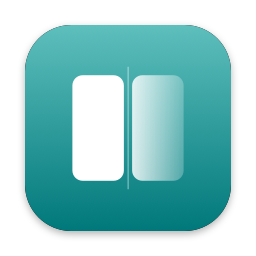

<p align="center">
  
</p>

<h1 align="center">Cermin</h1>

<p align="center">
  <strong>Mirror iPhone ke jendela Mac biasa. Tanpa watermark, tanpa fullscreen, gratis dan offline.</strong>
</p>

<p align="center">
  <a href="https://github.com/ramdanegie/iphone-mirror-mac/releases"></a>
  
  
  
  <a href="LICENSE"></a>
</p>

<p align="center">
  <a href="README.md">English</a> · Bahasa Indonesia
</p>

---

Cermin menampilkan layar iPhone di **jendela macOS biasa**: bisa digeser, di-resize, dan dibuat *always on top*. iPhone tetap bisa dipakai di tangan, dan Mac tetap bisa dipakai penuh. Dibuat untuk menunjukkan app iPhone saat meeting tanpa AirPlay Receiver bawaan yang mengambil alih seluruh layar.

## Kenapa Cermin

- 🪟 **Jendela sungguhan, tidak pernah fullscreen.** Geser, ubah ukuran, selalu di atas, sudut membulat mengikuti layar iPhone.
- 🔌 **USB dulu.** Mekanisme yang sama dengan QuickTime: latensi paling rendah, tanpa setup jaringan, tanpa install apa pun di iPhone.
- 📶 **Wireless juga bisa.** AirPlay receiver di dalam jendela Cermin (iPhone dan Mac di Wi-Fi yang sama), diamankan dengan kode di layar. Tanpa install apa pun di iPhone.
- 🙈 **Privacy Curtain.** Satu hotkey global (`⌃⌥⌘P`) mengganti tampilan dengan kartu netral, untuk momen-momen saat share layar.
- 🔒 **Wireless fail-closed.** Frame ditahan sampai kamu menekan *Izinkan*, kecuali perangkat sudah ditandai selalu diizinkan.
- 📸 **Screenshot** (`⌘S`) resolusi asli ke file PNG dan clipboard.
- 🔊 **Audio iPhone di Mac**, dengan on/off dan volume.
- 🔄 **Mengikuti rotasi** dan mengingat ukuran serta posisi jendela per perangkat.
- 🧰 Toolbar di samping jendela, di luar area yang di-share, jadi tidak ikut tampil di meeting.
- 🌏 **Bahasa Indonesia dan English**, mengikuti bahasa Mac atau pilihanmu di Pengaturan → Umum.

## Instalasi

**Kebutuhan:** Mac Apple Silicon (M1 ke atas) dengan macOS 14 ke atas, dan iPhone.

1. Unduh `Cermin-x.y.z.dmg` terbaru dari [Releases](https://github.com/ramdanegie/iphone-mirror-mac/releases).
2. Buka, lalu seret **Cermin** ke **Applications**.
3. Buka Cermin. Build belum dinotarisasi, jadi macOS tidak bisa memeriksanya: klik **Done**, lalu buka **System Settings → Privacy & Security** dan klik **Open Anyway**. (Atau jalankan `xattr -dr com.apple.quarantine /Applications/Cermin.app`.)
4. Colok iPhone dengan kabel data, buka kuncinya, dan ketuk **Percayai**. Izinkan akses **Kamera** saat diminta: macOS memperlakukan layar iPhone yang dicolok sebagai perangkat capture. Kamera Mac tidak pernah dipakai.

Cermin bisa memberi tahu saat ada versi baru (Pengaturan → Tentang → Periksa sekarang, atau cek harian yang kamu nyalakan) dan menampilkan perubahan setelah tiap update; lihat [CHANGELOG.id.md](CHANGELOG.id.md). Cermin tetap offline kecuali fitur ini dipakai.

### Wireless (AirPlay), sekali saja

Buka **Pengaturan → Wireless** di Cermin, lalu salin perintah pemasangan ke Terminal. Butuh [Homebrew](https://brew.sh); perintah ini mem-build [UxPlay](https://github.com/FDH2/UxPlay) 1.74 (commit `534e2cc`, dikunci) ke `~/Library/Application Support/Cermin/bin/uxplay`. Dari folder source, bisa juga `./scripts/install-uxplay.sh`.

- Matikan **AirPlay Receiver bawaan** (System Settings → General → AirDrop & Handoff). Kalau tidak, iPhone melihat dua tujuan, dan yang bawaan selalu fullscreen.
- Cermin memakai port lokal 7300–7302 dan 5600. Kalau firewall aktif, izinkan koneksi masuk untuk `uxplay`.
- Kode cukup dimasukkan sekali per iPhone; Cermin menyimpan identitas AirPlay-nya supaya iPhone tetap mengenali Mac setelah restart.
- Jangan pakai UxPlay v1.73.7 (rilis resmi terakhir / versi Homebrew): pairing kodenya menolak iOS 27, sehingga iPhone meminta kode terus-menerus.
- Mode P2P (tanpa Wi-Fi yang sama) masih eksperimental.

## Shortcut

| Aksi | Shortcut |
|---|---|
| Privacy Curtain (global, bisa diganti) | `⌃⌥⌘P` |
| Screenshot (PNG resolusi asli, juga ke clipboard) | `⌘S` |
| Selalu di atas | `⌘T` |
| Ukuran 50% / 75% / 100% / Fit | `⌘1` – `⌘4` |
| Sembunyikan/tampilkan jendela | `⌥⌘M` |

Sebelum meeting telemedicine atau dengan klien: nyalakan Focus di iPhone, pakai data dummy, dan coba hotkey curtain sekali.

## Build dari source

Cukup Command Line Tools (Xcode tidak wajib).

```bash
git clone https://github.com/ramdanegie/iphone-mirror-mac.git
cd iphone-mirror-mac
./scripts/build.sh --test --run    # unit test, build/Cermin.app, lalu buka
```

- Pindahkan `build/Cermin.app` ke `/Applications` supaya **Buka saat login** berfungsi.
- Secara default build ditandatangani ad-hoc, jadi macOS meminta izin Kamera lagi setiap build ulang. Tandatangani dengan sertifikatmu supaya izin bertahan: `CERMIN_SIGN_IDENTITY="Apple Development: …" ./scripts/build.sh`.
- `./scripts/dmg.sh` membuat DMG seret-ke-Applications.

### Tes dan alat debug

- `swift test` menguji logika murni: state machine mirror, ukuran dan rotasi jendela, depacketizer RTP/H.264, parser log dan argumen UxPlay, register perangkat tepercaya, dan hotkey.
- `.build/debug/Cermin --snapshot /tmp/shots` merender semua layar (light dan dark) ke PNG.
- `CERMIN_UXPLAY=<script> CERMIN_LOG=1 .build/debug/Cermin` menjalankan app dengan UxPlay palsu dan mencetak state tiap detik, jadi jalur wireless (kode → izin → decode H.264 → rotasi → putus) bisa dites tanpa iPhone. Tambahkan `CERMIN_AUTOANSWER=approve|deny` untuk menjawab prompt Izinkan/Tolak otomatis.
- Tes yang butuh perangkat asli ada di checklist [PRD.md](PRD.md) (Bagian 5).

## Struktur

```
Sources/CerminCore/   logika murni + unit test: state machine, ukuran jendela, RTP/H.264, log UxPlay, register perangkat
Sources/Cermin/       app: Capture/ (USB, AirPlay) · Render/ · Window/ · Features/ · UI/ · App/
Tests/                swift test
scripts/              build.sh · dmg.sh · install-uxplay.sh · make-icon.swift
PRD.md, design/       spesifikasi produk dan design board
```

## Kontribusi

Issue dan pull request sangat diterima. Jalankan `./scripts/build.sh --test` sebelum membuka PR. Swift 6, SwiftPM, tanpa dependensi Swift pihak ketiga.

Teks UI ditulis dalam Bahasa Indonesia di kode dan diterjemahkan di `Resources/en.lproj/Localizable.strings`; `./scripts/check-strings.sh` (bagian dari `--test`) gagal bila ada teks tanpa terjemahan English.

Kalau Cermin berguna buatmu, ⭐ membantu orang lain menemukannya.

## Pembuat

Dibuat oleh **Egie Ramdan** · [github.com/ramdanegie](https://github.com/ramdanegie)

## Lisensi

Kode Cermin berlisensi [MIT](LICENSE). UxPlay (dipakai untuk wireless) tidak ikut di repo ini maupun di app: script pemasangan mengunduh dan mem-build-nya di Mac kamu. Lisensi UxPlay adalah GPL-3.0.
