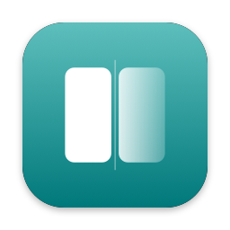

<p align="center">
  
</p>

<h1 align="center">Cermin</h1>

<p align="center">
  <strong>Mirror your iPhone into a regular Mac window. No watermark, no fullscreen, free and offline.</strong>
</p>

<p align="center">
  <a href="https://github.com/ramdanegie/iphone-mirror-mac/releases"></a>
  
  
  
  <a href="LICENSE"></a>
</p>

<p align="center">
  English · <a href="README.id.md">Bahasa Indonesia</a>
</p>

---

*Cermin* means "mirror" in Indonesian. It shows your iPhone screen in a normal macOS window that you can move, resize, and keep on top, while the phone stays in your hand and your Mac stays usable. Built for sharing an iPhone app in a meeting without the built-in AirPlay receiver taking over the whole screen.

## Why Cermin

- 🪟 **A real window, never fullscreen.** Move it, resize it, keep it always on top, round its corners like the iPhone screen.
- 🔌 **USB first.** The same mechanism QuickTime uses: lowest latency, no network setup, nothing to install on the iPhone.
- 📶 **Wireless too.** An AirPlay receiver inside the Cermin window (iPhone and Mac on the same Wi-Fi), secured with an on-screen code. Nothing to install on the iPhone.
- 🙈 **Privacy Curtain.** One global hotkey (`⌃⌥⌘P`) swaps the screen for a neutral card, for those moments in a screen share.
- 🔒 **Wireless is fail-closed.** Frames stay hidden until you click *Allow*, unless you marked the device as always trusted.
- 📸 **Screenshots** (`⌘S`) in full resolution to a PNG file and the clipboard.
- 🔊 **iPhone audio on the Mac**, with on/off and volume.
- 🔄 **Follows rotation** and remembers window size and position per device.
- 🧰 A side toolbar that stays outside the shared window, so it never shows up in your meeting.
- 🌏 **English and Bahasa Indonesia**, following your Mac's language or your choice in Settings → General.

## Install

**Requirements:** a Mac with Apple Silicon (M1 or later) on macOS 14 or later, and an iPhone.

1. Download the latest `Cermin-x.y.z.dmg` from [Releases](https://github.com/ramdanegie/iphone-mirror-mac/releases).
2. Open it and drag **Cermin** to **Applications**.
3. Open Cermin. Builds are not notarized yet, so macOS cannot verify it: click **Done**, then go to **System Settings → Privacy & Security** and click **Open Anyway**. (Or run `xattr -dr com.apple.quarantine /Applications/Cermin.app`.)
4. Plug in the iPhone with a data cable, unlock it, and tap **Trust**. Allow **Camera** access when asked: macOS treats a plugged-in iPhone screen as a capture device. Your Mac's camera is never used.

Cermin can tell you when a new version is out (Settings → About → Check now, or a daily check you turn on) and shows what changed after each update; see [CHANGELOG.md](CHANGELOG.md). It stays offline unless you use that.

### Wireless (AirPlay), once

Open **Settings → Wireless** in Cermin and copy the install command into Terminal. It needs [Homebrew](https://brew.sh) and builds [UxPlay](https://github.com/FDH2/UxPlay) 1.74 (pinned commit `534e2cc`) into `~/Library/Application Support/Cermin/bin/uxplay`. From a source checkout you can also run `./scripts/install-uxplay.sh`.

- Turn off the **built-in AirPlay Receiver** (System Settings → General → AirDrop & Handoff). Otherwise the iPhone sees two targets, and the built-in one is always fullscreen.
- Cermin uses local ports 7300–7302 and 5600. If the firewall is on, allow incoming connections for `uxplay`.
- Enter the code once per iPhone; Cermin keeps its AirPlay identity so the iPhone still recognizes the Mac after a restart.
- Do not use UxPlay v1.73.7 (the last official release and the Homebrew version): its code pairing rejects iOS 27, so the iPhone keeps asking for the code.
- P2P mode (no shared Wi-Fi) is still experimental.

## Shortcuts

| Action | Shortcut |
|---|---|
| Privacy Curtain (global, configurable) | `⌃⌥⌘P` |
| Screenshot (full-resolution PNG, also to the clipboard) | `⌘S` |
| Always on top | `⌘T` |
| Size 50% / 75% / 100% / Fit | `⌘1` – `⌘4` |
| Hide or show the window | `⌥⌘M` |

Before a telemedicine or client meeting: turn on a Focus mode on the iPhone, use dummy data, and try the curtain hotkey once.

## Build from source

Only the Command Line Tools are needed (Xcode is optional).

```bash
git clone https://github.com/ramdanegie/iphone-mirror-mac.git
cd iphone-mirror-mac
./scripts/build.sh --test --run    # unit tests, build/Cermin.app, then open it
```

- Move `build/Cermin.app` to `/Applications` so **Open at login** works.
- Builds are signed ad-hoc by default, so macOS asks for Camera access again after each rebuild. Sign with your own certificate to keep it: `CERMIN_SIGN_IDENTITY="Apple Development: …" ./scripts/build.sh`.
- `./scripts/dmg.sh` packs a drag-to-Applications DMG.

### Tests and debug tools

- `swift test` covers the pure logic: the mirror state machine, window sizing and rotation, the RTP/H.264 depacketizer, the UxPlay log parser and arguments, the trusted-device register, and hotkeys.
- `.build/debug/Cermin --snapshot /tmp/shots` renders every screen (light and dark) to PNG.
- `CERMIN_UXPLAY=<script> CERMIN_LOG=1 .build/debug/Cermin` runs the app against a fake UxPlay and prints the state every second, so the wireless path (code → allow → H.264 decode → rotation → disconnect) can be tested without an iPhone. Add `CERMIN_AUTOANSWER=approve|deny` to answer the Allow/Deny prompt automatically.
- Tests that need real devices are in the checklist in [PRD.md](PRD.md) (Part 5).

## Project layout

```
Sources/CerminCore/   pure logic + unit tests: state machine, window sizing, RTP/H.264, UxPlay log, device register
Sources/Cermin/       the app: Capture/ (USB, AirPlay) · Render/ · Window/ · Features/ · UI/ · App/
Tests/                swift test
scripts/              build.sh · dmg.sh · install-uxplay.sh · make-icon.swift
PRD.md, design/       product spec (in Indonesian) and design board
```

## Contributing

Issues and pull requests are welcome. Run `./scripts/build.sh --test` before opening a PR. Swift 6, SwiftPM, no third-party Swift dependencies.

UI text is written in Indonesian in the code and translated in `Resources/en.lproj/Localizable.strings`; `./scripts/check-strings.sh` (part of `--test`) fails when a string has no English translation.

If Cermin is useful to you, a ⭐ helps other people find it.

## Author

Made by **Egie Ramdan** · [github.com/ramdanegie](https://github.com/ramdanegie)

## License

Cermin's code is [MIT](LICENSE). UxPlay (used for wireless) is not part of this repository or the app: the install script downloads and builds it on your Mac. UxPlay is licensed under GPL-3.0.
