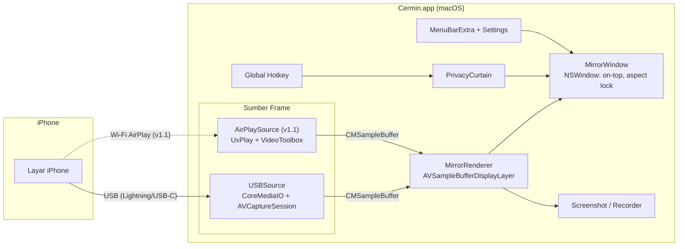

# PRD — Cermin: Mirror iPhone ke macOS (tanpa watermark, Mac tetap bisa dipakai)

| Field | Isi |
|---|---|
| Nama produk (kerja) | **Cermin** (boleh diganti) |
| Platform | macOS native (Swift + SwiftUI/AppKit) |
| Versi dokumen | 1.0 |
| Tanggal | 3 November 2026 |
| Owner | Egie |
| Status | Draft → siap untuk Claude Design → Claude Code |
| Alur kerja | **PRD (dokumen ini) → Claude Design (Bagian 3) → Claude Code (Bagian 4)** |

---

## Daftar Isi

1. **Bagian 1 — PRD**: masalah, tujuan, pengguna, lingkup, requirement, metrik, risiko
2. **Bagian 2 — Spec Fitur & Teknis**: arsitektur, stack, spec per fitur, izin
3. **Bagian 3 — Design Brief** (untuk Claude Design)
4. **Bagian 4 — Task Breakdown** (untuk Claude Code) + prompt pembuka
5. **Bagian 5 — Checklist Uji Manual**

---

# BAGIAN 1 — PRD

## 1.1 Ringkasan (TL;DR)

Cermin adalah aplikasi macOS untuk menampilkan layar iPhone di **jendela biasa** yang bisa digeser, diubah ukuran, dan dibuat *always-on-top*. Selama mirroring, **iPhone tetap bisa dipakai langsung** dan **Mac tetap bisa dipakai normal**. Tidak ada watermark, tidak berbayar, dan tidak butuh internet.

Kegunaan utama: **screen share saat meeting** (Zoom/Meet/Teams). Contohnya demo aplikasi telemedicine, di mana peserta perlu melihat aplikasi iOS dan aplikasi/dashboard macOS **bersamaan dalam satu share screen**.

- **MVP (v1.0):** mirror lewat **kabel USB**, pakai mekanisme yang sama dengan QuickTime. Latensi paling rendah, paling stabil, tanpa setup jaringan.
- **v1.1:** mirror **wireless (AirPlay receiver)** di dalam jendela Cermin, tidak fullscreen.
- **v1.2 (opsional):** **kontrol iPhone dari Mac** (klik/ketik dari Mac).

## 1.2 Latar Belakang & Masalah

| Solusi yang ada | Masalah |
|---|---|
| **iPhone Mirroring** (bawaan macOS) | iPhone **terkunci** selama mirroring, jadi tidak bisa dioperasikan langsung di tangan. |
| **AirPlay Screen Mirroring ke Mac** (AirPlay Receiver bawaan) | Tampilan di Mac jadi **fullscreen**, sehingga Mac tidak bisa dipakai dan tidak bisa share "iOS + macOS" bersamaan. |
| **ApowerMirror / Reflector 4** | **Berbayar**, versi gratis ada **watermark** atau batas waktu. |
| **QuickTime → New Movie Recording → pilih iPhone** | Sebenarnya jalan, tapi UI-nya untuk merekam, bukan untuk presentasi: tidak ada always-on-top, tidak ada privacy curtain, tidak ingat ukuran/posisi, ada kontrol rekam yang mengganggu. |

**Insight kunci:** macOS sudah punya jalur resmi untuk menangkap layar iPhone lewat USB (CoreMediaIO + AVFoundation, jalur yang dipakai QuickTime). Jalur ini **tidak mengunci iPhone** dan **tidak memaksa fullscreen**. Kita cukup membangun UI presentasi yang bagus di atasnya.

## 1.3 Tujuan & Non-Tujuan

### Tujuan
- G1. Mirror layar iPhone ke jendela macOS yang bisa di-resize, digeser, dan dibuat always-on-top.
- G2. iPhone dan Mac **sama-sama tetap bisa dioperasikan** selama mirroring.
- G3. Hasil mirror **siap di-share di meeting**: bersih, tanpa watermark, tanpa UI yang mengganggu.
- G4. Ada **perlindungan privasi** untuk demo telemedicine, yaitu tombol/hotkey untuk menyembunyikan layar seketika.
- G5. Gratis, offline, tanpa akun, tanpa telemetri.

### Non-Tujuan (tidak dikerjakan)
- Android, Windows, Linux.
- Distribusi App Store dan monetisasi.
- Mirror beberapa iPhone sekaligus (v1 cukup satu perangkat aktif).
- Mirror Mac ke iPhone (arah sebaliknya).
- Editor video, anotasi/menggambar di atas layar, streaming ke internet.
- Virtual camera (mengirim mirror sebagai "kamera" ke Zoom). Bisa dipertimbangkan nanti.

## 1.4 Target Pengguna & Persona

**Persona utama — "Egie, Product/Engineer di perusahaan telemedicine"**
- Sering demo aplikasi iOS (pasien/dokter) sambil menunjukkan dashboard web/macOS ke klien, tim, atau stakeholder lewat Zoom/Meet.
- Butuh mengoperasikan iPhone **langsung di tangan** (tap, scroll, input) dan tampilannya muncul di Mac.
- Butuh share **seluruh layar Mac** supaya iOS dan macOS terlihat berdampingan.
- Peduli privasi data pasien: notifikasi atau data sensitif tidak boleh bocor saat share.

**Persona sekunder:** developer iOS yang ingin melihat layar iPhone di Mac saat debugging atau rekam demo.

## 1.5 User Stories

| ID | Sebagai… | Saya ingin… | Supaya… |
|---|---|---|---|
| US-1 | presenter | colok iPhone lalu layar langsung muncul di jendela Mac | tidak perlu setup ribet sebelum meeting |
| US-2 | presenter | tetap memakai iPhone dengan tangan selama mirroring | demo terasa natural seperti pengguna asli |
| US-3 | presenter | jendela mirror tetap di atas jendela lain (always-on-top) | saat pindah ke browser/dashboard, iPhone tetap terlihat |
| US-4 | presenter | share seluruh layar Mac di Zoom/Meet | peserta melihat iOS + macOS sekaligus ("double share") |
| US-5 | presenter telemedicine | menekan satu hotkey untuk menyembunyikan layar iPhone seketika | data pasien/notifikasi tidak bocor |
| US-6 | presenter | ukuran dan posisi jendela tersimpan | tidak perlu atur ulang tiap meeting |
| US-7 | presenter | ambil screenshot layar iPhone dari Mac | gampang bikin dokumentasi/bug report |
| US-8 | presenter | mirror tanpa kabel (AirPlay) di jendela biasa | lebih bebas bergerak (v1.1) |
| US-9 | power user | klik/ketik ke iPhone dari Mac | tidak perlu pegang iPhone (v1.2, opsional) |

## 1.6 Lingkup per Rilis

| Rilis | Isi | Alasan urutan |
|---|---|---|
| **v0 — Spike** | Bukti teknis: iPhone muncul sebagai capture device dan preview live tampil | Mengurangi risiko sebelum membangun UI |
| **v1.0 — MVP (USB)** | Mirror USB, jendela presentasi (always-on-top, aspect lock, ingat posisi), Privacy Curtain + hotkey, screenshot, audio toggle, menu bar, settings, onboarding izin | Memenuhi 100% kebutuhan meeting dengan risiko terendah |
| **v1.1 — Wireless** | AirPlay receiver di dalam jendela Cermin (bukan fullscreen), pilih sumber USB/Wireless | Permintaan "AirCast"; lebih kompleks dan berisiko protokol |
| **v1.2 — Kontrol (opsional)** | Kontrol iPhone dari Mac (tap/scroll/ketik) | Butuh perangkat tambahan atau signing developer, jadi bukan inti |
| Nanti | Rekam video, device frame, virtual camera, crop status bar | Nice-to-have |

## 1.7 Requirement Fungsional (MoSCoW)

### v1.0 — MVP (USB)

| ID | Requirement | Prioritas |
|---|---|---|
| FR-1 | Mendeteksi iPhone yang dicolok via USB, lalu mulai mirror otomatis setelah iPhone di-unlock dan di-Trust | Must |
| FR-2 | Menampilkan layar iPhone live di jendela non-fullscreen, aspect ratio terkunci sesuai layar iPhone | Must |
| FR-3 | Mengikuti rotasi iPhone (portrait ↔ landscape) dan menyesuaikan ukuran jendela otomatis | Must |
| FR-4 | Toggle **Always on Top** (tombol, menu, dan shortcut) | Must |
| FR-5 | Jendela **tidak pernah** masuk fullscreen; Mac tetap bisa dipakai penuh | Must |
| FR-6 | **Privacy Curtain**: hotkey global yang langsung mengganti tampilan dengan kartu netral "Layar disembunyikan sementara" | Must |
| FR-7 | Auto-reconnect ketika kabel dicabut lalu dicolok lagi, atau iPhone terkunci lalu dibuka | Must |
| FR-8 | Status jelas saat belum ada perangkat, perangkat terkunci/belum Trust, atau terputus | Must |
| FR-9 | Onboarding izin Kamera (dan Mikrofon jika audio aktif), dengan penjelasan kenapa dibutuhkan | Must |
| FR-10 | Menyimpan ukuran dan posisi jendela per perangkat | Should |
| FR-11 | Screenshot (⌘S) ke file PNG + clipboard | Should |
| FR-12 | Audio iPhone diputar di Mac: on/off + volume | Should |
| FR-13 | Ikon Menu Bar: status, show/hide jendela, toggle on-top, curtain, screenshot, quit | Should |
| FR-14 | Preset ukuran jendela (50% / 75% / 100% / Fit tinggi layar) | Should |
| FR-15 | Settings: default on-top, audio, folder screenshot, hotkey, launch at login | Should |
| FR-16 | Sudut jendela membulat mengikuti bentuk layar iPhone (tanpa bezel) | Should |
| FR-17 | Device frame (bezel iPhone) opsional | Could |
| FR-18 | Rekam video ke file (.mov) | Could |
| FR-19 | Mode "Freeze" (bekukan frame terakhir) sebagai alternatif curtain | Could |

### v1.1 — Wireless

| ID | Requirement | Prioritas |
|---|---|---|
| FR-20 | Cermin tampil sebagai target AirPlay ("Cermin") di Control Center → Screen Mirroring iPhone | Must |
| FR-21 | Video AirPlay ditampilkan di **jendela Cermin yang sama** (semua fitur FR-2 s/d FR-16 berlaku), bukan fullscreen | Must |
| FR-22 | Pilih sumber: USB / Wireless (otomatis pilih USB bila keduanya tersedia) | Should |
| FR-23 | Panduan untuk mematikan "AirPlay Receiver" bawaan macOS bila bentrok port | Must |

### v1.2 — Kontrol dari Mac (opsional)

| ID | Requirement | Prioritas |
|---|---|---|
| FR-30 | Klik pada jendela mirror menjadi tap di iPhone; drag menjadi swipe | Could |
| FR-31 | Ketik dari keyboard Mac ke field yang aktif di iPhone | Could |
| FR-32 | Tombol Home/App Switcher/Lock | Could |

## 1.8 Requirement Non-Fungsional

| ID | Kategori | Target |
|---|---|---|
| NFR-1 | Latensi USB (glass-to-glass) | ≤ 150 ms (target ≤ 100 ms) |
| NFR-2 | Frame rate USB | Mengikuti iPhone, hingga 60 fps |
| NFR-3 | Latensi Wireless | ≤ 300 ms |
| NFR-4 | Waktu hingga frame pertama | ≤ 3 detik setelah colok + unlock |
| NFR-5 | Resource (Apple Silicon, ukuran 75%) | CPU ≤ 15%, RAM ≤ 250 MB |
| NFR-6 | Stabilitas | Sesi 60 menit tanpa crash/freeze; reconnect ≤ 3 detik |
| NFR-7 | Privasi | Mode USB 100% offline; tidak ada telemetri; frame tidak disimpan kecuali user screenshot/rekam |
| NFR-8 | Kompatibilitas | macOS 14 Sonoma ke atas (dikembangkan di macOS 27); Apple Silicon (Intel best-effort); iOS 15 ke atas |
| NFR-9 | Branding | **Tidak ada watermark**, tidak ada nag screen |
| NFR-10 | Aksesibilitas | Semua tombol punya label VoiceOver dan shortcut; mengikuti Light/Dark mode |

## 1.9 Metrik Sukses

- Dipakai di **≥ 3 meeting nyata** tanpa harus kembali ke ApowerMirror/QuickTime.
- Setup sebelum meeting **≤ 10 detik** (colok → muncul).
- **0 insiden** data sensitif tampil tidak sengaja saat share (Privacy Curtain dipakai bila perlu).
- Tidak ada keluhan "Mac tidak bisa dipakai" atau "iPhone terkunci" selama mirroring.

## 1.10 Asumsi, Risiko & Mitigasi

| # | Risiko | Dampak | Mitigasi |
|---|---|---|---|
| R1 | macOS meminta **izin Kamera** untuk capture layar iPhone (iPhone dianggap capture device) | User bingung | Onboarding menjelaskan "macOS memperlakukan layar iPhone seperti kamera" |
| R2 | Selama capture USB, **audio iPhone bisa pindah ke Mac** (speaker iPhone senyap). Bisa mengganggu saat demo video call telemedicine di iPhone | Sedang | Diuji di Spike. Sediakan toggle audio; dokumentasikan perilakunya |
| R3 | **Notifikasi** (chat pasien, OTP) muncul di mirror saat share | Tinggi (privasi) | Privacy Curtain + rekomendasi **Focus Mode** di iPhone; checklist sebelum meeting |
| R4 | Kabel hanya untuk charging (tanpa data) | iPhone tidak terdeteksi | Pesan troubleshooting di empty state |
| R5 | Device Continuity Camera ikut terdeteksi di discovery | Salah pilih device | Filter berdasarkan media type `muxed` / model "iOS Device" |
| R6 | Wireless: protokol AirPlay dibalik-rekayasa (UxPlay) dan bisa rusak setelah update iOS | v1.1 terganggu | USB tetap jadi jalur utama; pin versi UxPlay; uji setiap update iOS besar |
| R7 | Wireless: **lisensi UxPlay GPL-3.0** | Kalau app dibagikan, source code wajib dibuka (GPL) | Pemakaian pribadi aman; putuskan sebelum distribusi |
| R8 | Wireless: bentrok port dengan AirPlay Receiver bawaan macOS (port 7000) | Gagal listen | Deteksi + panduan mematikan di System Settings |
| R9 | Kontrol dari Mac: macOS tidak menyediakan API publik andal untuk menjadi mouse/keyboard Bluetooth ke iPhone | Fitur v1.2 butuh jalan lain | Lihat opsi di §2.4 F9 (WebDriverAgent atau dongle ESP32) |

## 1.11 Pertanyaan Terbuka

1. Nama "Cermin" oke, atau ada nama lain?
2. Audio iPhone perlu diputar di Mac, atau cukup video saja?
3. Seberapa penting wireless dibanding USB? (Rekomendasi: USB dulu.)
4. Kontrol dari Mac benar-benar dibutuhkan? Kalau ya, pilih jalur dongle ESP32 (perlu hardware ±Rp100rb) atau WebDriverAgent (perlu Xcode + Apple ID)?
5. App hanya untuk pribadi, atau akan dibagikan ke tim? (Berpengaruh ke signing/notarisasi dan lisensi GPL di v1.1.)

---

# BAGIAN 2 — SPEC FITUR & TEKNIS

## 2.1 Arsitektur



**Prinsip:** setiap sumber menghasilkan `CMSampleBuffer` dan **satu renderer** menampilkannya, sehingga semua fitur jendela (on-top, curtain, screenshot) otomatis berlaku untuk USB maupun wireless.

## 2.2 Tech Stack

| Lapisan | Pilihan | Catatan |
|---|---|---|
| Bahasa | Swift 6 | Strict concurrency |
| UI | SwiftUI (Settings, MenuBarExtra, onboarding) + AppKit (`NSWindow` untuk jendela mirror) | AppKit dibutuhkan untuk window level, aspect ratio, dan fullscreen behavior |
| Capture USB | `CoreMediaIO` + `AVFoundation` (`AVCaptureSession`, `AVCaptureVideoDataOutput`, `AVCaptureAudioPreviewOutput`) | Jalur yang sama dengan QuickTime |
| Render | `AVSampleBufferDisplayLayer` | Fallback: `AVCaptureVideoPreviewLayer` bila latensi lebih baik |
| Hotkey global | Carbon `RegisterEventHotKey` | Tidak butuh izin Accessibility |
| Penyimpanan setting | `UserDefaults` / `@AppStorage` | Tanpa database |
| Launch at login | `SMAppService.mainApp` | |
| Wireless (v1.1) | [UxPlay](https://github.com/FDH2/UxPlay) (GPL-3.0) + `VideoToolbox` | Dependensi: OpenSSL, libplist (Homebrew) |
| Project gen | **XcodeGen** (`project.yml`) | Ramah AI agent: tidak perlu edit `.pbxproj` |
| Dependensi pihak ketiga v1.0 | **Tidak ada** | |

## 2.3 Struktur Folder

```
Cermin/
├── project.yml                 # XcodeGen
├── Cermin/
│   ├── App/CerminApp.swift     # @main, MenuBarExtra, Settings scene
│   ├── Capture/
│   │   ├── USBSource.swift     # CMIO enable, discovery, AVCaptureSession
│   │   └── AirPlaySource.swift # v1.1
│   ├── Render/MirrorView.swift # NSView + AVSampleBufferDisplayLayer
│   ├── Window/MirrorWindowController.swift
│   ├── Features/
│   │   ├── PrivacyCurtain.swift
│   │   ├── Screenshot.swift
│   │   └── HotKey.swift
│   ├── UI/                     # Onboarding, EmptyState, Toolbar, Settings (SwiftUI)
│   ├── Info.plist
│   └── Cermin.entitlements
├── CerminTests/                # unit test logika murni (sizing, state machine)
└── scripts/build.sh            # xcodegen + xcodebuild + jalankan
```

## 2.4 Spec per Fitur

### F1 — USB Mirror (FR-1, 2, 3, 7, 8)

**Alur teknis:**
1. Saat app start, aktifkan screen capture devices di CoreMediaIO:
   - `CMIOObjectSetPropertyData` pada `kCMIOObjectSystemObject` dengan selector `kCMIOHardwarePropertyAllowScreenCaptureDevices` = `1`.
2. Cari device dengan `AVCaptureDevice.DiscoverySession(deviceTypes: [.external], mediaType: .muxed, position: .unspecified)`. Untuk macOS < 14 pakai `.externalUnknown`.
   - Device bisa baru muncul **1–3 detik** setelah properti di-set. Observasi `devices` (KVO) + `AVCaptureDevice.wasConnectedNotification` / `wasDisconnectedNotification`.
3. Buat `AVCaptureSession` → `AVCaptureDeviceInput(device:)` → `AVCaptureVideoDataOutput` (kirim frame ke renderer, simpan frame terakhir untuk screenshot) → `AVCaptureAudioPreviewOutput` (audio, bila aktif).
4. Rotasi/resolusi berubah: deteksi perubahan dimensi `CMFormatDescription` lalu update `contentAspectRatio` jendela dengan **tinggi jendela tetap**, lebar menyesuaikan.
5. Jalankan session di background queue, jangan di main thread.

**State machine perangkat:**

```
idle ──(device muncul)──▶ connecting ──(frame pertama)──▶ mirroring
  ▲                          │                               │
  │                     (timeout 5 dtk:                  (device hilang)
  │                   "Buka kunci & Trust")                  │
  └────────────(device hilang)◀──────── disconnected ◀───────┘
                                   (auto retry saat device muncul lagi)
```

**Acceptance criteria:**
- [ ] iPhone yang sudah Trust dan unlocked tampil ≤ 3 detik setelah colok.
- [ ] iPhone tetap bisa dioperasikan normal; jendela mirror ikut berubah real-time.
- [ ] Rotasi iPhone → jendela menyesuaikan ≤ 500 ms tanpa distorsi.
- [ ] Cabut lalu colok ulang → otomatis lanjut tanpa klik apa pun.
- [ ] Hanya device iPhone/iPad (muxed) yang dipilih, bukan Continuity Camera.

### F2 — Jendela Presentasi (FR-2, 4, 5, 10, 14, 16)

- `NSWindow` dengan `titlebarAppearsTransparent`, `.fullSizeContentView`, judul tersembunyi; traffic lights muncul hanya saat hover.
- `contentAspectRatio` = rasio layar iPhone, sehingga resize selalu proporsional.
- `collectionBehavior` menyertakan `.fullScreenNone`, sehingga jendela **tidak bisa** fullscreen (tombol hijau = zoom ke preset "Fit tinggi").
- Always on Top: `window.level = .floating` (toggle). Default dari Settings.
- Sudut membulat: corner radius proporsional terhadap lebar jendela (mirip layar iPhone).
- Ukuran dan posisi disimpan per `device.uniqueID`.
- Drag jendela dari mana saja (di v1.0 klik di area video tidak dikirim ke iPhone).

**Acceptance criteria:**
- [ ] Tidak ada cara (klik/shortcut) yang membuat jendela fullscreen.
- [ ] Saat on-top aktif, jendela tetap terlihat ketika pindah ke app lain dan saat share screen di Zoom/Meet.
- [ ] Restart app → ukuran/posisi kembali seperti terakhir.

### F3 — Privacy Curtain (FR-6, FR-19)

- Hotkey global default **⌃⌥⌘P** (bisa diubah) + tombol di toolbar + menu bar.
- Saat aktif: renderer **berhenti menampilkan frame** dan menampilkan kartu netral (logo kecil + "Layar disembunyikan sementara"). **Default: blank**, bukan freeze, karena frame terakhir bisa berisi data sensitif.
- Ikon menu bar berubah (mis. ikon mata dicoret) sebagai indikator.
- Transisi ≤ 100 ms (tanpa animasi panjang; keamanan lebih penting dari estetika).

**Acceptance criteria:**
- [ ] Hotkey bekerja walaupun app lain sedang fokus (misalnya Zoom/browser).
- [ ] Di rekaman share screen, tidak ada satu pun frame berisi layar iPhone setelah hotkey ditekan.

### F4 — Screenshot (FR-11)
- ⌘S / tombol toolbar: simpan frame terakhir (resolusi asli iPhone) sebagai PNG ke folder setting (default `~/Pictures/Cermin/Cermin YYYY-MM-DD HH.mm.ss.png`) dan salin ke clipboard. Tampilkan toast "Screenshot tersimpan".
- Saat Privacy Curtain aktif, screenshot dinonaktifkan.

### F5 — Audio (FR-12)
- `AVCaptureAudioPreviewOutput` dengan `volume`. Toggle on/off, default **off** (perilaku dikonfirmasi di Spike; lihat R2).

### F6 — Menu Bar (FR-13)
- `MenuBarExtra`: nama device + status (●Mirroring / ○Menunggu), Show/Hide Window, Always on Top ✓, Privacy Curtain ✓, Screenshot, Settings…, Quit.

### F7 — Settings (FR-15)
Tab **Umum** (launch at login, default on-top) · **Tampilan** (sudut membulat, device frame) · **Audio** · **Shortcut** · **Wireless** (v1.1) · **Tentang**.

### F8 — Wireless / AirPlay Receiver (v1.1)
- Basis: **UxPlay** (open-source AirPlay mirroring server, mendukung macOS).
- Spike menentukan integrasi:
  - **Opsi A (cepat, prototipe):** jalankan `uxplay` sebagai subprocess. Kelemahan: render di jendela GStreamer, bukan jendela Cermin.
  - **Opsi B (target):** link bagian protokol UxPlay (`lib/`) ke app, ambil H.264 dari callback, decode dengan `VideoToolbox`, lalu kirim `CMSampleBuffer` ke renderer yang sama dengan USB. Semua fitur jendela ikut berlaku.
- Advertise Bonjour (`_airplay._tcp`, `_raop._tcp`) dengan nama "Cermin". Butuh `NSLocalNetworkUsageDescription` + `NSBonjourServices` di Info.plist.
- Port default UxPlay 7000/7001/7100 bentrok dengan **AirPlay Receiver** bawaan macOS, jadi app mendeteksi dan memandu user mematikannya (System Settings → General → AirDrop & Handoff → AirPlay Receiver).
- **Lisensi GPL-3.0**: aman untuk pribadi; kalau dibagikan, source wajib dibuka.

### F9 — Kontrol dari Mac (v1.2, opsional)

| Opsi | Cara kerja | Plus | Minus |
|---|---|---|---|
| **A. WebDriverAgent (XCUITest)** | Install runner WDA ke iPhone via Xcode; Mac kirim tap/swipe/type lewat HTTP over USB (`go-ios`/`pymobiledevice3` untuk tunnel iOS 17+) | Tanpa hardware tambahan | Butuh Xcode + Developer Mode; Apple ID gratis = re-sign tiap 7 hari; latensi gesture 200–500 ms |
| **B. Dongle BLE HID (ESP32-S3)** | ESP32 jadi mouse+keyboard Bluetooth ke iPhone (aktifkan AssistiveTouch); Mac kirim perintah via USB serial | Responsif, terasa native, tanpa signing | Perlu hardware ±Rp100rb + firmware |

Rekomendasi: tunda sampai v1.0 dipakai di meeting nyata. Bisa jadi tidak dibutuhkan, karena use case utama mengoperasikan iPhone langsung di tangan.

## 2.5 Izin, Info.plist & Entitlements

| Item | Nilai/Alasan |
|---|---|
| `NSCameraUsageDescription` | "Cermin membutuhkan akses 'Kamera' karena macOS memperlakukan layar iPhone yang dicolok sebagai perangkat capture." |
| `NSMicrophoneUsageDescription` | "Untuk memutar audio iPhone di Mac." |
| `NSLocalNetworkUsageDescription` + `NSBonjourServices` | v1.1 saja (AirPlay) |
| Entitlements (Hardened Runtime) | `com.apple.security.device.camera`, `com.apple.security.device.audio-input` |
| App Sandbox | **Off** untuk v1.0 (distribusi pribadi; menyederhanakan CMIO & v1.1 networking) |
| Signing | "Sign to Run Locally" / Apple ID gratis; notarisasi hanya bila dibagikan |

---

# BAGIAN 3 — DESIGN BRIEF (untuk Claude Design)

> **Instruksi untuk Claude Design:** rancang UI aplikasi macOS native bernama **Cermin** untuk mirror iPhone ke Mac. Gaya: **native macOS** (SF Pro, material/vibrancy sistem, semantic colors, Light & Dark). Utamakan **minimal dan tidak mengganggu**, karena jendela ini akan dilihat peserta meeting. Hasil desain harus mudah diimplementasikan dengan **SwiftUI + AppKit**.

## 3.1 Prinsip Desain
1. **Konten adalah raja.** Saat mirroring, yang terlihat hampir hanya layar iPhone. Kontrol muncul hanya saat hover.
2. **Aman dipresentasikan.** Tidak ada elemen alarm (merah/berkedip) di area yang ikut ter-share. State privasi tampil netral dan profesional.
3. **Native.** Ikuti macOS Human Interface Guidelines: SF Symbols, ukuran kontrol standar, shortcut terlihat di menu.
4. **Nol kebingungan saat setup.** Empty state menjelaskan langkah dengan bahasa sederhana (Bahasa Indonesia).

## 3.2 Daftar Layar & State

| ID | Layar | Isi utama |
|---|---|---|
| D1 | **Onboarding** (3 langkah, sekali saja) | (1) Selamat datang + nilai utama, (2) Izin Kamera beserta penjelasan "kenapa kamera?", (3) Colok iPhone → Trust → Unlock. Tombol "Mulai" |
| D2 | **Empty State – Menunggu iPhone** | Ilustrasi iPhone + kabel, teks "Colokkan iPhone dengan kabel data", checklist status: Kabel terdeteksi → Buka kunci iPhone → Ketuk "Trust/Percayai". Link "Tidak terdeteksi?" (kabel data, Trust, restart) |
| D3 | **Connecting** | Spinner kecil + nama device |
| D4 | **Mirroring (utama)** | Layar iPhone memenuhi jendela, sudut membulat, tanpa chrome. **Saat hover:** toolbar mengambang di atas (material blur) berisi Pin (always on top), Screenshot, Privacy Curtain, Audio, Ukuran (50/75/100/Fit), Settings. Pill status kecil di bawah: "USB · 60 fps" (hilang setelah 2 detik) |
| D5 | **Privacy Curtain aktif** | Area mirror diganti kartu netral: ikon `eye.slash`, teks "Layar disembunyikan sementara", hint hotkey "⌃⌥⌘P untuk menampilkan". Warna netral, rasio jendela tetap |
| D6 | **Terputus** | Overlay "iPhone terputus — menunggu tersambung kembali…" di atas frame terakhir yang di-blur kuat |
| D7 | **Menu Bar** | Ikon template (siluet iPhone); menu sesuai F6; state curtain tampil di ikon |
| D8 | **Settings** | Jendela Settings macOS standar dengan tab: Umum, Tampilan, Audio, Shortcut, Wireless, Tentang |
| D9 | **Toast** | "Screenshot tersimpan" (kapsul kecil, 1,5 detik, di dalam jendela mirror) |
| D10 | **Wireless – siap menerima** (v1.1) | "Di iPhone: Control Center → Screen Mirroring → pilih **Cermin**", plus peringatan bila AirPlay Receiver bawaan masih aktif |
| D11 | **Pilih sumber** (v1.1) | Segmented control USB / Wireless di toolbar/menu |

## 3.3 Komponen & Token
- **Jendela mirror:** default tinggi 75% visible screen height; lebar mengikuti rasio iPhone (contoh 1179×2556). Corner radius ≈ 9% dari lebar jendela. Bayangan jendela standar macOS.
- **Toolbar hover:** tinggi 36pt, ikon SF Symbols 15pt, material `.hudWindow`/`.ultraThinMaterial`, radius 10pt, fade 150 ms.
- **Spacing:** 4 / 8 / 12 / 16 / 24.
- **Warna:** semantic system colors + 1 accent (usulan: teal/biru medis yang tenang). Hindari merah kecuali error.
- **Tipografi:** SF Pro (Title 2 untuk empty state, Body/Callout untuk teks, Caption untuk status pill).
- **Ikon app:** konsep "cermin" + "iPhone": dua persegi panjang membulat bertumpuk/terpantul, gaya macOS Big Sur+ (squircle).

## 3.4 Copy (Bahasa Indonesia)
- Empty state: **"Colokkan iPhone kamu"** / "Pakai kabel data. Buka kunci iPhone dan ketuk *Percayai* bila diminta."
- Curtain: **"Layar disembunyikan sementara"**
- Terputus: **"iPhone terputus. Menunggu tersambung kembali…"**
- Izin kamera: **"Kenapa butuh akses Kamera?** macOS memperlakukan layar iPhone yang dicolok sebagai perangkat kamera. Cermin tidak memakai kamera Mac kamu."

## 3.5 Output yang Diharapkan dari Claude Design
1. Mockup D1–D9 (Light & Dark), D10–D11 opsional.
2. Spesifikasi komponen (ukuran, radius, material, state hover/pressed/disabled).
3. Ikon app (1024px) + ikon menu bar template (16/18pt).
4. Catatan implementasi SwiftUI (nama SF Symbols, material yang dipakai).

---

# BAGIAN 4 — TASK BREAKDOWN (untuk Claude Code)

> Kerjakan **berurutan**. Tiap task selesai bila acceptance criteria (AC) terpenuhi dan `scripts/build.sh` berhasil. Logika murni (kalkulasi ukuran jendela, state machine, penamaan file) wajib punya unit test; bagian yang butuh hardware diverifikasi lewat checklist Bagian 5.

## Phase 0 — Spike (wajib sebelum UI)

**T0.1 — Setup project**
- XcodeGen `project.yml`: target macOS app `Cermin`, deployment target macOS 14, Swift 6, Hardened Runtime, Info.plist + entitlements sesuai §2.5, target test `CerminTests`.
- `scripts/build.sh`: `xcodegen generate && xcodebuild -scheme Cermin -configuration Debug build`, lalu buka app.
- **AC:** `./scripts/build.sh` sukses dan app kosong terbuka.

**T0.2 — Bukti capture USB**
- Aktifkan `kCMIOHardwarePropertyAllowScreenCaptureDevices`, discovery `.muxed`, log `localizedName`/`modelID`/`uniqueID`, tampilkan preview live sederhana.
- **AC:** iPhone muncul ≤ 3 detik setelah colok + unlock; preview live; iPhone tetap bisa dipakai.
- **Catat temuan:** (a) apakah audio iPhone pindah ke Mac, (b) status bar iPhone saat capture, (c) latensi kasar (stopwatch on-screen di iPhone vs mirror), (d) perlu izin Kamera atau tidak, (e) membandingkan latensi `AVSampleBufferDisplayLayer` vs `AVCaptureVideoPreviewLayer`. Tulis hasilnya ke `docs/spike-usb.md`.

## Phase 1 — MVP v1.0

| Task | Isi | AC |
|---|---|---|
| **T1.1** USBSource | Discovery + connect/disconnect + state machine (§F1) + `AVCaptureSession` di background queue | Cabut/colok → state benar; unit test state machine |
| **T1.2** MirrorRenderer | `NSView` + `AVSampleBufferDisplayLayer`, simpan frame terakhir | 60 fps stabil, CPU ≤ 15% |
| **T1.3** MirrorWindow | Aspect lock, `.fullScreenNone`, on-top toggle, sudut membulat, rotasi, simpan frame per device | AC §F2; unit test kalkulasi ukuran saat rotasi |
| **T1.4** Empty/Connecting/Disconnected | UI D2, D3, D6 | Tiap state tampil sesuai kondisi |
| **T1.5** Hover toolbar + shortcuts | UI D4; ⌘S, ⌘T (on-top), ⌘1/2/3/4 (preset ukuran) | Toolbar hanya muncul saat hover |
| **T1.6** Privacy Curtain + global hotkey | §F3, `RegisterEventHotKey`, UI D5 | AC §F3 |
| **T1.7** Screenshot | §F4, toast D9 | PNG resolusi asli + clipboard; nonaktif saat curtain |
| **T1.8** Audio | §F5 | Toggle + volume bekerja |
| **T1.9** Menu bar | §F6, UI D7 | Semua aksi berfungsi, indikator curtain |
| **T1.10** Settings | §F7, `@AppStorage`, `SMAppService` | Setting tersimpan antar restart |
| **T1.11** Onboarding & izin | UI D1, `AVCaptureDevice.requestAccess(for: .video)`, handle ditolak (link ke System Settings) | First run mulus; izin ditolak → pesan jelas |
| **T1.12** Polish & README | Ikon app dari Claude Design, README cara build/pakai, checklist Bagian 5 lulus | Lulus semua checklist |

## Phase 2 — Wireless v1.1

| Task | Isi | AC |
|---|---|---|
| **T2.1** Spike UxPlay | Build UxPlay di macOS (Homebrew deps), coba mirror dari iPhone; catat latensi; tentukan Opsi A/B (§F8) | `docs/spike-airplay.md` berisi keputusan |
| **T2.2** AirPlaySource | Integrasi sesuai keputusan; H.264 → VideoToolbox → renderer yang sama | Mirror wireless di jendela Cermin, bukan fullscreen |
| **T2.3** Source picker + deteksi bentrok port | UI D10, D11 | Panduan muncul bila AirPlay Receiver bawaan aktif |

## Phase 3 — Kontrol dari Mac v1.2 (opsional)
- **T3.1** Spike opsi A (WDA) atau B (ESP32), lalu putuskan.
- **T3.2** Mapping koordinat klik di jendela ke koordinat layar iPhone (unit test), kirim tap/swipe/type.

## 4.1 Prompt Pembuka untuk Claude Code

```
Baca PRD.md di root project. Kita bangun app macOS "Cermin" (Swift 6, SwiftUI + AppKit,
macOS 14+), tanpa dependensi pihak ketiga untuk v1.0. Mulai dari Phase 0:
kerjakan T0.1 lalu T0.2, berhenti setelah T0.2 dan laporkan temuan spike
(docs/spike-usb.md) sebelum lanjut ke Phase 1. Desain UI ada di folder design/
(hasil Claude Design). Ikuti acceptance criteria tiap task.
```

---

# BAGIAN 5 — CHECKLIST UJI MANUAL

### Dasar
- [ ] Colok iPhone (sudah Trust) → mirror muncul ≤ 3 detik.
- [ ] Pakai iPhone (scroll, buka app, ketik) → mirror real-time, iPhone **tidak terkunci**.
- [ ] Pakai Mac (pindah app, ketik di browser) → Mac **tidak terganggu**, jendela mirror tidak fullscreen.
- [ ] Rotasi iPhone → jendela menyesuaikan.
- [ ] Cabut/colok kabel, kunci/buka iPhone → auto-reconnect.

### Meeting (double share)
- [ ] **Zoom** → Share Screen → *Desktop/Entire Screen* → peserta melihat mirror + app macOS bersamaan.
- [ ] **Google Meet** (Chrome/Safari) → *Entire screen* → sama seperti di atas.
- [ ] **Microsoft Teams** → *Screen* → sama seperti di atas.
- [ ] Share **hanya jendela Cermin** → peserta hanya melihat iPhone.
- [ ] Always on Top aktif saat fokus di Zoom/browser → mirror tetap terlihat.
- [ ] Tekan ⌃⌥⌘P saat sedang share → curtain muncul seketika di sisi peserta (cek di device kedua).

### Privasi telemedicine (sebelum meeting)
- [ ] Aktifkan **Focus Mode** (Do Not Disturb) di iPhone.
- [ ] Pakai akun/data **dummy** pasien untuk demo.
- [ ] Uji hotkey Privacy Curtain sekali sebelum mulai.

### Stabilitas
- [ ] Sesi 60 menit: tanpa crash, tanpa memory naik terus (cek Activity Monitor).
- [ ] CPU ≤ 15% di ukuran 75%.
